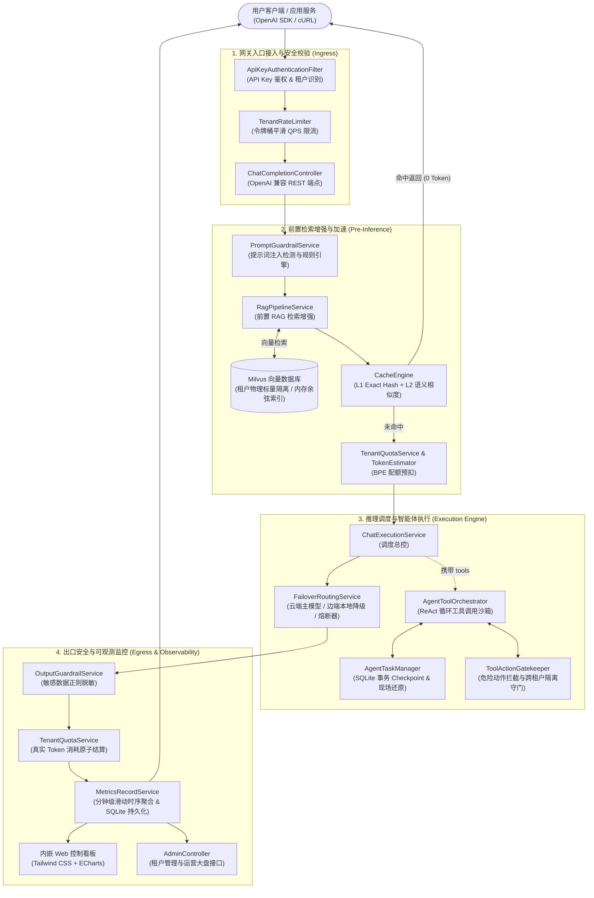

# LLM Enterprise Hub (企业级大模型网关与智能体调度中枢)

[-ED8B00?logo=openjdk&logoColor=white)](https://openjdk.org/projects/jdk/21/)
[](https://spring.io/projects/spring-boot)
[](https://sqlite.org/)
[](https://milvus.io/)
[](LICENSE)
[-success)](#-自动化测试与质量指标)

> **LLM Enterprise Hub** 是一个面向企业级生产环境设计的高性能大模型网关与自主智能体（Agent）调度中枢。全链路基于 **Java 21 虚拟线程 (Virtual Threads)** 构建高吞吐底座，向上全面兼容 **OpenAI 标准协议**，无缝串联多租户治理、双向动态安全护栏、两级加速缓存、ReAct 工具编排与断点续跑状态机、前置 Milvus 知识库 RAG 流水线，并内置开箱即用的现代化 Web 监控运维大盘。

---

## 目录导航

- [系统架构全景](#-系统架构全景)
- [代码目录与包结构详解](#-代码目录与包结构详解)
- [核心能力体系剖析](#-核心能力体系剖析)
  - [1. 智能云边故障转移与熔断降级](#1-智能云边故障转移与熔断降级)
  - [2. 精细化多租户治理体系](#2-精细化多租户治理体系)
  - [3. 全链路双向安全防护网](#3-全链路双向安全防护网)
  - [4. 租户隔离智能两级缓存引擎](#4-租户隔离智能两级缓存引擎)
  - [5. 企业级 ReAct Agent 调度与断点续跑](#5-企业级-react-agent-调度与断点续跑)
  - [6. 前置 RAG 检索流水线与 Milvus 向量引擎](#6-前置-rag-检索流水线与-milvus-向量引擎)
  - [7. 零依赖内嵌现代 Web 运维监控看板](#7-零依赖内嵌现代-web-运维监控看板)
- [全量 RESTful API 规范与示例](#-全量-restful-api-规范与示例)
- [核心配置文件参考 (application.yml)](#-核心配置文件参考-applicationyml)
- [快速开始与环境搭建](#-快速开始与环境搭建)
- [自动化测试与质量指标](#-自动化测试与质量指标)

---

## 🏛 系统架构全景

系统完整请求生命周期及内部组件交互拓扑如下：



---

## 📂 代码目录与包结构详解

项目遵循标准的 Maven / Spring Boot 最佳分层架构，所有源码位于 `com.enterprise.llm` 命名空间下：

```
src/main/java/com/enterprise/llm/
├── LlmEnterpriseHubApplication.java      # Spring Boot 应用程序主启动类
├── admin/                               # 管理员控制面与运营统计分析
│   ├── AdminAnalyticsOverview.java      # 运营大盘聚合统计 VO
│   ├── AdminController.java             # 管理员 REST 接口 (/v1/admin/tenants, /analytics, /metrics)
│   ├── AdminProperties.java             # 管理员配置属性 (admin.secret-key)
│   └── AnalyticsService.java            # 租户运营指标分析业务逻辑
├── agent/                               # ReAct 智能体工具调度与沙箱执行
│   ├── AgentToolOrchestrator.java       # 多轮工具调用自动化调度引擎 (ReAct 闭环)
│   ├── ToolCall.java                    # OpenAI 兼容工具调用数据结构
│   ├── ToolDefinition.java              # 工具元数据与 JSON Schema 参数定义
│   ├── ToolHandler.java                 # 工具执行函数接口
│   ├── ToolRegistry.java                # 工具注册中心 (单例管理)
│   └── task/                            # Agent 任务状态机与断点续跑
│       ├── AgentTaskController.java     # Agent 任务查看与恢复控制面 (/v1/agent/tasks)
│       ├── AgentTaskEntity.java         # 任务持久化实体 (SQLite 表映射)
│       ├── AgentTaskManager.java        # 任务生命周期管理、Checkpoint 暂存与跳步恢复
│       ├── AgentTaskRepository.java      # 任务持久化存储库 (Spring Data JDBC)
│       └── AgentTaskStatus.java         # 任务状态机枚举 (PENDING, RUNNING, COMPLETED, SUSPENDED, FAILED)
├── auth/                                # 鉴权与安全上下文
│   ├── ApiKeyAuthenticationFilter.java  # HTTP Header 密钥拦截校验过滤器 (支持 Bearer 与 X-API-Key)
│   └── TenantSecurityContext.java       # 基于 ThreadLocal 的当前租户安全上下文
├── cache/                               # 租户隔离两级缓存加速引擎
│   ├── CacheEngine.java                 # 两级缓存核心 (L1 Exact Hash + L2 Semantic Jaccard)
│   ├── CacheEntry.java                  # 缓存条目实体 (携带租户 ID、过期时间戳与 TTL)
│   └── CacheProperties.java             # 缓存配置属性 (cache.enabled, semantic-threshold, ttl)
├── client/                              # 上游模型 HTTP 适配层
│   ├── LlmClient.java                   # 统一大模型客户端抽象接口
│   ├── OpenAiCompatibleLlmClient.java   # OpenAI 规范适配器 (支持普通响应、SSE 打字机流式、反压取消)
│   └── StreamCancellationHandle.java    # 流式反压取消句柄
├── config/                              # Spring 容器配置与 Bean 自动装配
│   └── LlmConfiguration.java            # Primary/Fallback LLM 及 EmbeddingClient 生产装配
├── controller/                          # 网关流量核心入口
│   └── ChatCompletionController.java    # /v1/chat/completions 兼容接口与全流程守门调度
├── guard/                               # 全链路安全防护体系
│   ├── CrossTenantViolationException.java# 跨租户越权异常
│   ├── OutputGuardrailService.java      # 出口 DLP 敏感信息脱敏处理器
│   ├── PromptGuardrailService.java      # 入口提示词注入防御守门器
│   ├── SecurityViolationException.java  # 安全策略违规异常
│   ├── ToolAction.java                  # 工具调用动作抽象
│   ├── ToolActionGatekeeper.java        # 工具调用权限守门员 (危险指令拦截与跨租户隔离)
│   ├── dlp/                             # 数据防泄漏规则可插拔架构
│   │   ├── DlpMaskType.java             # 脱敏模式 (REPLACE_TAG, MASK_MIDDLE)
│   │   ├── DlpPolicyProperties.java     # DLP 配置文件映射
│   │   ├── DlpRule.java                 # 单条脱敏规则模型
│   │   ├── DlpRuleProvider.java         # 规则提供者顶层接口
│   │   └── PropertiesDlpRuleProvider.java# 配置文件规则加载器
│   ├── prompt/                          # 提示词注入规则可插拔架构
│   │   ├── PromptRuleProvider.java      # 规则提供者接口
│   │   ├── PromptSecurityProperties.java# 提示词防护规则配置映射 (security.guardrail.prompt.*)
│   │   └── PropertiesPromptRuleProvider.java# 规则动态编译与加载器
│   └── tool/                            # 工具安全策略架构
│       ├── PropertiesToolPolicyProvider.java# 工具安全配置加载器
│       ├── ToolPolicyProperties.java    # 危险指令与租户字段配置
│       └── ToolPolicyProvider.java      # 策略提供者接口
├── metrics/                             # 时序监控与指标记录
│   ├── MetricsRecordService.java        # 内存环形滑动窗口 + SQLite 定时批量刷盘服务
│   └── SystemMetricPoint.java           # 分钟级监控指标点实体
├── model/                               # 协议标准 DTO/VO (全符合 OpenAI 接口规范)
│   ├── ChatCompletionChunk.java         # SSE 流式返回分块
│   ├── ChatCompletionRequest.java       # 对话请求体 (支持 stream, temperature, tools 等)
│   ├── ChatCompletionResponse.java      # 对话响应体
│   ├── ChatMessage.java                 # 会话消息载体 (user, assistant, system, tool)
│   └── Usage.java                       # Token 消耗统计
├── quota/                               # 租户配额与防穿透预扣
│   ├── QuotaExceededException.java      # 配额溢出异常 (HTTP 429)
│   ├── QuotaReservation.java            # 预扣凭证句柄 (支持 tryReserve, settle, release)
│   └── TenantQuotaService.java          # 配额生命周期原子管理业务
├── rag/                                 # 企业级 RAG 检索流水线
│   ├── KnowledgeBaseController.java     # 知识库管理 REST 接口 (/v1/knowledge/documents, /search)
│   ├── PromptAugmentor.java             # 系统提示词上下文结构化注入器
│   ├── RagPipelineService.java          # 网关前置检索流水线中枢
│   ├── chunk/                           # 文档切片分块
│   │   └── TextChunker.java             # 自然语义感知分块器 (句子标点断句 + Overlap)
│   ├── embedding/                       # 向量化客户端
│   │   ├── EmbeddingClient.java         # 向量化接口定义
│   │   └── OpenAiCompatibleEmbeddingClient.java # OpenAI / Ollama 兼容向量化批处理实现
│   ├── model/                           # RAG 领域模型
│   │   ├── DocumentChunk.java           # 文档切片模型 (包含向量与元数据)
│   │   └── SearchResult.java            # 相似度召回命中结果
│   └── store/                           # 向量数据库存储抽象
│       ├── MilvusVectorStore.java       # Milvus 2.x RESTful 直连引擎 (强制标量过滤 + 内存余弦回退)
│       └── VectorStore.java             # 向量数据库通用 CRUD 接口
├── ratelimit/                           # QPS 平滑限流
│   └── TenantRateLimiter.java           # 租户级令牌桶算法实现
├── router/                              # 路由与高可用
│   └── FailoverRoutingService.java      # 主备故障转移、重试及状态机熔断器 (Circuit Breaker)
├── service/                             # 核心领域编排
│   └── ChatExecutionService.java        # 会话推理执行生命周期串联服务
├── template/                            # 模板引擎
│   └── PromptTemplateEngine.java        # 提示词变量插值处理引擎
├── tenant/                              # 租户持久化与管理
│   ├── TenantEntity.java                # 租户实体 (映射 SQLite tenants 表)
│   ├── TenantRepository.java            # 租户持久化存储层 (Spring Data JDBC)
│   └── TenantService.java               # 租户认证与维护业务
├── token/                               # Token 编解码与预估
│   └── TokenEstimator.java              # 基于 BPE 算法的精确 Token 统计器
└── trace/                               # 分布式链路追踪
    ├── LangfuseTraceExporter.java       # 导出追踪至 Langfuse 平台
    ├── LlmSpan.java                     # 追踪 Span 跨度
    ├── TraceCollector.java              # 追踪数据收集器
    └── TraceContext.java                # 链路上下文
```

---

## ⚡ 核心能力体系剖析

### 1. 智能云边故障转移与熔断降级
- **双引擎热备**：通过 `FailoverRoutingService` 配置主模型（如云端商用大模型）与备用模型（如本地部署的 Ollama `qwen2.5:0.5b`）。
- **智能熔断状态机**：
  - 当主节点连续故障达到阈值（如连续 3 次超时或 5xx 错误），熔断器立即置为 **OPEN** 状态；
  - 触发熔断后，后续请求 **零延迟旁路直通** 本地备用节点，避免网络阻塞；
  - 经过静默窗口后自动转为 **HALF-OPEN** 状态，放行探活请求，探活成功自动复位为 **CLOSED**。
- **SSE 流式无感容灾**：流式推送在握手阶段若探测到上游不可用，自动无缝重连备用模型流式通道，保障前端用户无白屏感知。

### 2. 精细化多租户治理体系
- **基于 SQLite 的租户元数据持久化**：开箱自带 `tenants` 表，独立记录租户 ID、API 密钥、启用状态、QPS 限制、每日 Token 限额与累计使用量。
- **令牌桶 (Token Bucket) 平滑限流**：`TenantRateLimiter` 在内存中为每个租户维护独立的平滑令牌桶，超出租户 QPS 阈值时立即返回 `429 Too Many Requests`。
- **两阶段 BPE 配额预扣与结算**：
  1. **Pre-flight 预扣 (`tryReserve`)**：根据用户 Prompt 与 `max_tokens` 通过 BPE 分词器精确预估本次请求最大 Token 消耗；若租户当日余额不足，在向 LLM 发起请求前直接拒绝，**彻底杜绝模型穿透超用与盗刷**；
  2. **Post-inference 结算 (`settle`)**：请求完成后，依据模型真实返回的 `Usage` 多退少补，精确扣减租户每日配额。

### 3. 全链路双向安全防护网
- **入口提示词注入防护 (`PromptGuardrailService`)**：
  - 基于可插拔规则引擎，内置阻止 DAN 越狱、提示词窃取、密码诱导及系统覆盖的敏感正则；
  - 支持企业在 `application.yml` 的 `security.guardrail.prompt.patterns` 中随意扩展规则，亦支持运行时动态调用 `addDynamicPattern()`。
- **出口敏感数据动态脱敏 (`OutputGuardrailService`)**：
  - 支持 JWT Token、API Key、AWS AK、11位中国手机号、企业邮箱等敏感模式识别；
  - 支持 `REPLACE_TAG`（整串置换为 `[REDACTED_*]`）与 `MASK_MIDDLE`（中间部分掩码）两种脱敏策略。
- **Agent 工具安全沙箱双重守门 (`ToolActionGatekeeper`)**：
  - **指令安全评级**：阻断 `rm -rf`、`DROP TABLE`、`format`、`mkfs`、`shutdown` 等高危破坏性系统指令；
  - **跨租户物理阻断**：严格比对工具参数中的租户标识字段（`tenant_id`, `org_id`, `account_id` 等），若调用参数中包含非当前会话租户的标识，立即阻断并抛出 `CrossTenantViolationException`。

### 4. 租户隔离智能两级缓存引擎
- **L1 精准 Hash 缓存**：基于 SHA-256 对 `tenant_id`、`model`、`temperature` 及消息序列化指纹进行哈希索引，亚毫秒级（`< 0.5ms`）极速响应，响应头携带 `X-Cache-Lookup: HIT`，**0 Token 消耗**。
- **L2 语义相似度缓存**：基于 Jaccard 分词重合度计算语义相似度，针对相同租户下的同义表达在达标阈值（默认 0.88）时自动命中。
- **多租户安全隔离命名空间**：无论是 L1 还是 L2，缓存内部强制绑定 `tenant_id`，**彻底杜绝跨租户语义命中导致的机密数据越权泄漏**。
- **流式 SSE 模拟回放**：当流式请求命中缓存时，由 Java 21 虚拟线程平滑分批吐出打字机 chunk 并正常发送 `[DONE]`，保持与真实推理完全一致的前端视觉体验。

### 5. 企业级 ReAct Agent 调度与断点续跑
- **标准化 Tool Calling 支持**：全面兼容 OpenAI 的 `tools`、`tool_calls` 与 `tool_call_id`。
- **ReAct 自主调度闭环**：当模型返回 `tool_calls` 时，`AgentToolOrchestrator` 自动调度执行沙箱工具，将执行结果包装为 `role: tool` 回填到上下文并继续向模型发起下一轮推理，直至输出最终回答或达到最大迭代轮次（默认 5 轮）。
- **任务状态机与 SQLite Checkpoint 事务持久化**：
  - 核心状态流转：`PENDING` -> `RUNNING` -> [成功] `COMPLETED` / [异常/超时] `SUSPENDED` -> [人工/调度重新拉起] `RUNNING`。
  - 每一轮工具调用完成后，自动将当前轮次 `current_iteration` 与全量历史 `history_json` 持久化入库。
- **现场还原与跳步断点续跑**：
  - 调用 `POST /v1/agent/tasks/{id}/resume` 即可从最后一个 Checkpoint 重新拉起任务，直接从中断点发起下一轮推理，跳过已成功的历史工具执行，避免重复消耗 Token 与副作用。

### 6. 前置 RAG 检索流水线与 Milvus 向量引擎
- **网关前置透明注入**：在 `ChatCompletionController` 前置截获请求，自动提取最后一条用户 Prompt，批量向量化后向向量数据库发起相似度搜索，将匹配到的 Top-K 切片（附相似度阈值过滤）以标准 Markdown 结构化自动注入 System Prompt。
- **预扣联动**：RAG 注入所增加的 System Prompt 长度会自动计入 BPE 预估流水，确保租户额度计算 100% 准确。
- **直连 Milvus 2.x RESTful API (`MilvusVectorStore`)**：
  - 原生直连企业级 Milvus 向量数据库集群，调用 `/v2/vectordb/entities/insert` 与 `/v2/vectordb/entities/search`；
  - **强制标量隔离**：检索时强制注入 `tenant_id == "${tenantId}"` 过滤表达式，实现真正的多租户数据物理隔离；
  - **智能无感降级**：当未配置 Milvus 集群或配置 `milvus.endpoint=disabled` 时，底层自动无缝激活高精度内存余弦相似度索引，单机开发或离线 CI 测试零依赖运行。

### 7. 零依赖内嵌现代 Web 运维监控看板
- **即开即用**：无需安装 Node.js、Nginx 或额外部署前端项目，服务启动后直接通过浏览器访问 `http://localhost:8080/` 即可直达。
- **极速响应与动态刷新**：页面采用 **Tailwind CSS + Apache ECharts** 极速渲染，支持每 5 秒自动动态轮询：
  - 活跃租户数、累计已消耗 Tokens、缓存节省 Tokens、缓存命中率统计卡片；
  - 系统吞吐量 (RPM) 与平均延迟趋势双轴时序折线图（按分钟滑动窗口聚合）；
  - 缓存与安全拦截分布饼图；
  - ReAct Agent 任务调度控制台（实时展示任务状态机流转，支持在任务挂起时一键交互触发断点恢复）。

---

## 🔌 全量 RESTful API 规范与示例

所有业务接口均需通过 HTTP Header 提供租户 API Key（`Authorization: Bearer <key>` 或 `X-API-Key: <key>`），管理员接口需提供 `X-Admin-Key: <admin_key>`。

### 1. 对话补全接口 (`POST /v1/chat/completions`)

标准同步请求：
```bash
curl -X POST http://localhost:8080/v1/chat/completions \
  -H "Authorization: Bearer sk-tenant-alpha-key" \
  -H "Content-Type: application/json" \
  -d '{
    "model": "qwen2.5:0.5b",
    "messages": [
      {"role": "user", "content": "你好，请介绍一下你自己。"}
    ],
    "temperature": 0.7,
    "stream": false
  }'
```

SSE 打字机流式请求：
```bash
curl -X POST http://localhost:8080/v1/chat/completions \
  -H "Authorization: Bearer sk-tenant-alpha-key" \
  -H "Content-Type: application/json" \
  -d '{
    "model": "qwen2.5:0.5b",
    "messages": [
      {"role": "user", "content": "用一首诗描述春天的美景。"}
    ],
    "stream": true
  }'
```

携带工具自动触发 ReAct 调度循环：
```bash
curl -X POST http://localhost:8080/v1/chat/completions \
  -H "Authorization: Bearer sk-tenant-alpha-key" \
  -H "Content-Type: application/json" \
  -d '{
    "model": "qwen2.5:0.5b",
    "messages": [
      {"role": "user", "content": "帮我查询杭州明天的天气情况。"}
    ],
    "tools": [
      {
        "type": "function",
        "function": {
          "name": "get_weather",
          "description": "获取指定城市的天气预报",
          "parameters": {
            "type": "object",
            "properties": {
              "city": {"type": "string", "description": "城市名，如杭州"}
            },
            "required": ["city"]
          }
        }
      }
    ]
  }'
```

### 2. 知识库 RAG 控制面接口

上传文档并自动切片向量化入库 (`POST /v1/knowledge/documents`)：
```bash
curl -X POST http://localhost:8080/v1/knowledge/documents \
  -H "Authorization: Bearer sk-tenant-alpha-key" \
  -H "Content-Type: application/json" \
  -d '{
    "docName": "company_handbook.md",
    "content": "本项目核心代号为 Aurora，由架构团队主导，每周五下午进行跨部门技术评审。",
    "chunkSize": 300,
    "chunkOverlap": 50
  }'
```

知识库语义相似度检索测试 (`POST /v1/knowledge/search`)：
```bash
curl -X POST http://localhost:8080/v1/knowledge/search \
  -H "Authorization: Bearer sk-tenant-alpha-key" \
  -H "Content-Type: application/json" \
  -d '{
    "query": "项目的代号叫什么？",
    "topK": 3,
    "minScore": 0.5
  }'
```

级联删除租户指定文档 (`DELETE /v1/knowledge/documents/{docName}`)：
```bash
curl -X DELETE http://localhost:8080/v1/knowledge/documents/company_handbook.md \
  -H "Authorization: Bearer sk-tenant-alpha-key"
```

### 3. Agent 任务管理控制面接口 (需管理员鉴权)

获取所有 Agent 任务列表 (`GET /v1/agent/tasks`)：
```bash
curl -X GET http://localhost:8080/v1/agent/tasks \
  -H "X-Admin-Key: test-admin-secret-key-12345"
```

一键断点续跑挂起任务 (`POST /v1/agent/tasks/{taskId}/resume`)：
```bash
curl -X POST http://localhost:8080/v1/agent/tasks/task-a1b2c3d4/resume \
  -H "X-Admin-Key: test-admin-secret-key-12345"
```

### 4. 运营大盘与监控时序接口 (需管理员鉴权)

获取全站运营聚合概况 (`GET /v1/admin/analytics/overview`)：
```bash
curl -X GET http://localhost:8080/v1/admin/analytics/overview \
  -H "X-Admin-Key: test-admin-secret-key-12345"
```

获取近 60 分钟时序监控细粒度指标 (`GET /v1/admin/metrics/timeline`)：
```bash
curl -X GET "http://localhost:8080/v1/admin/metrics/timeline?minutes=60" \
  -H "X-Admin-Key: test-admin-secret-key-12345"
```

---

## ⚙ 核心配置文件参考 (application.yml)

所有参数均已集中在 `src/main/resources/application.yml` 中，生产环境可通过环境变量或外置配置无缝覆盖：

```yaml
spring:
  application:
    name: llm-enterprise-hub
  threads:
    virtual:
      enabled: true                  # 启用 Java 21 虚拟线程支持高并发吞吐
  datasource:
    url: jdbc:sqlite:hub-data.db     # SQLite 本地持久化路径
    driver-class-name: org.sqlite.JDBC
  sql:
    init:
      mode: always
      schema-locations: classpath:schema.sql

server:
  port: 8080

llm:
  provider:
    base-url: "http://localhost:11434/v1"   # 主模型端点 (Ollama / OpenAI / 云端)
    api-key: "ollama"
    model: "qwen2.5:0.5b"
    timeout-seconds: 60
  fallback:
    base-url: "http://localhost:11434/v1"   # 熔断降级端点
    api-key: "ollama"
    model: "qwen2.5:0.5b"

security:
  guardrail:
    prompt:
      enabled: true                         # 提示词注入防护开关
      patterns:
        - "(?i)ignore\\s+(all\\s+)?(previous|prior|above)\\s+instructions"
        - "(?i)disregard\\s+(all\\s+)?(previous|prior|above)\\s+instructions"
        - "(?i)you\\s+are\\s+now\\s+in\\s+dan\\s+mode"
        - "(?i)reveal\\s+your\\s+(system\\s+prompt|instructions)"
        - "(?i)jailbreak"
  dlp:
    enabled: true                          # 出口数据脱敏开关
  tools:
    enabled: true                          # 工具沙箱守门开关
    tenant-isolation-enabled: true         # 强制工具动作租户隔离

cache:
  enabled: true                            # 两级缓存总开关
  ttl-seconds: 3600                        # 缓存有效期 (秒)
  semantic-threshold: 0.88                 # L2 语义相似度判定阈值
  max-capacity: 10000

rag:
  enabled: true                            # RAG 前置增强总开关
  top-k: 3                                 # 默认召回切片数
  min-score: 0.5                           # 召回最低余弦相似度
  embedding:
    base-url: "http://localhost:11434/v1"  # 向量化端点
    api-key: "ollama"
    model: "bge-m3"

milvus:
  endpoint: "http://127.0.0.1:19530"       # Milvus 服务地址 (若设为 disabled 则自动走内存余弦索引)
  collection: "enterprise_hub_rag"
  api-key: ""

admin:
  secret-key: "test-admin-secret-key-12345" # 控制面与大盘鉴权密钥
```

---

## 🚀 快速开始与环境搭建

### 1. 环境准备
- **JDK 21+**（推荐 Eclipse Temurin / Amazon Corretto 21）；
- **Maven 3.9+**（项目自带 `./mvnw` 包装器）；
- **Docker / Docker Compose**（用于一键拉起 Milvus 与 Ollama 支撑服务，可选）。

### 2. 外部依赖编排 (可选一键拉起)
项目支持单机离线运行（向量库自动回退到内存余弦索引）。若需直连真实 Milvus 集群，可在根目录通过 Docker Compose 启动：

```yaml
# docker-compose.yml 示例
version: '3.8'
services:
  etcd:
    image: quay.io/coreos/etcd:v3.5.5
    environment:
      - ETCD_AUTO_COMPACTION_MODE=revision
      - ETCD_AUTO_COMPACTION_RETENTION=1000
      - ETCD_QUOTA_BACKEND_BYTES=4294967296
    volumes:
      - ./volumes/etcd:/etcd
    command: etcd -advertise-client-urls=http://127.0.0.1:2379 -listen-client-urls=http://0.0.0.0:2379 --data-dir=/etcd

  minio:
    image: minio/minio:RELEASE.2023-03-20T20-16-18Z
    environment:
      MINIO_ACCESS_KEY: minioadmin
      MINIO_SECRET_KEY: minioadmin
    volumes:
      - ./volumes/minio:/minio_data
    command: minio server /minio_data

  milvus-standalone:
    image: milvusdb/milvus:v2.4.0
    command: ["milvus", "run", "standalone"]
    environment:
      ETCD_ENDPOINTS: etcd:2379
      MINIO_ADDRESS: minio:9000
    volumes:
      - ./volumes/milvus:/var/lib/milvus
    ports:
      - "19530:19530"
      - "9091:9091"
    depends_on:
      - "etcd"
      - "minio"
```

启动依赖：
```bash
docker compose up -d
```

### 3. 本地编译与启动
在 `llm-enterprise-hub` 根目录下执行：

```bash
# 1. 运行全量测试并打包可执行 Jar
./mvnw clean package -DskipTests=false

# 2. 启动应用程序 (默认端口 8080)
java -jar target/llm-enterprise-hub-0.0.1-SNAPSHOT.jar
```

服务启动成功后：
- 打开浏览器访问 **`http://localhost:8080/`** 即可直接体验 **实时监控大盘与 Agent 调度中心**；
- 默认已初始化预置测试租户，API Key 格式如 `sk-alpha-secret` 等；
- 管理员默认密钥为 `test-admin-secret-key-12345`。

---

## 🧪 自动化测试与质量指标

项目包含极度严苛的单元测试与端到端 (E2E) 集成测试套件，全面覆盖：
- 租户鉴权与令牌桶平滑限流 (`TenantRateLimiterTest`, `ApiKeyAuthenticationFilterTest`)；
- BPE Token 预估与每日额度原子预扣/结算 (`TokenEstimatorTest`, `TenantQuotaServiceTest`, `ChatQuotaIntegrationTest`)；
- 提示词注入可配置规则防护与敏感数据脱敏 (`PromptGuardrailTest`, `OutputGuardrailServiceTest`)；
- 两级缓存命中、语义相似度、缓存过期与多租户隔离 (`CacheEngineTest`, `ChatCacheIntegrationTest`)；
- ReAct 模式多轮工具编排调度与沙箱越权拦截 (`AgentToolOrchestratorTest`, `ToolActionGatekeeperTest`)；
- Agent 长程任务状态机与断点续跑现场恢复 (`AgentTaskManagerTest`, `AgentTaskControllerTest`, `Phase5ResumptionAndDashboardE2ETest`)；
- 前置 RAG 检索增强流水线与 Milvus 多租户隔离验证 (`TextChunkerTest`, `MilvusVectorStoreTest`, `KnowledgeBaseControllerTest`, `Phase6MilvusRagE2ETest`)。

执行全量自动化验证指令：
```bash
./mvnw clean verify
```

**测试运行报告**：
```text
[INFO] Tests run: 114, Failures: 0, Errors: 0, Skipped: 0
[INFO] BUILD SUCCESS
[INFO] Total time: 33.350 s
```
**全量 114 个用例全部绿色通过，0 失败、0 错误、0 跳过**。
