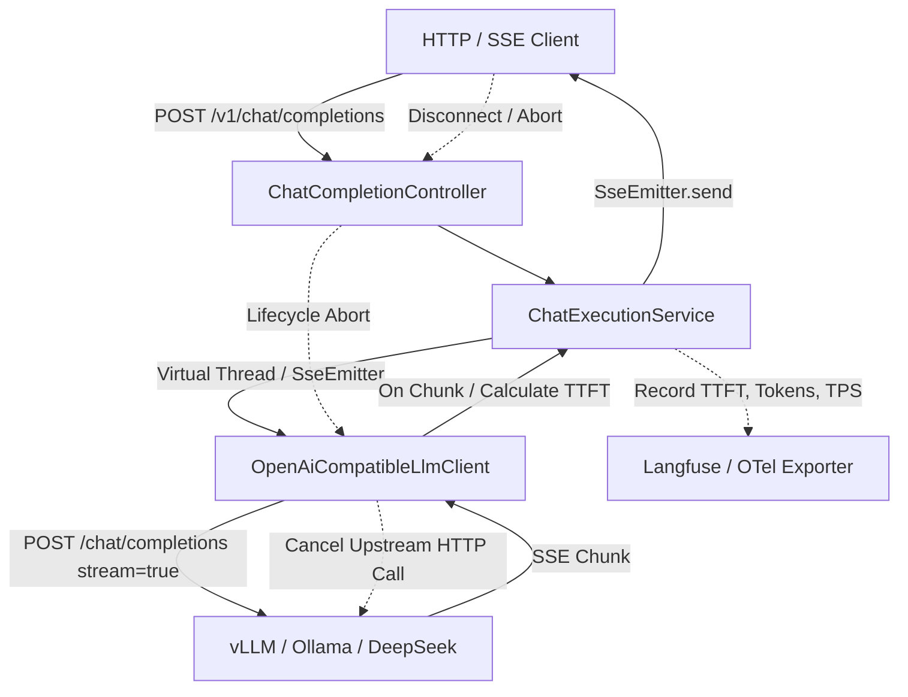

# LLM-Enterprise-Hub (Phase 1)

> 企业级大模型网关与推理调度中心 (Java 21 Virtual Threads + Spring Boot 3 + SSE 流式 Backpressure + OpenTelemetry/Langfuse 全链路观测)

---

## 架构概览

`llm-enterprise-hub` 第一阶段构建了高并发、高弹性的大模型统一接入网关基础核心：
- **OpenAI 兼容协议层**：支持标准 `/v1/chat/completions` 同步与 SSE 流式请求与响应规范。
- **高并发流式引擎**：基于 Java 21 虚拟线程 (`Executors.newVirtualThreadPerTaskExecutor`) 与非阻塞流式管道，提供极高连接吞吐。
- **客户端断连取消机制 (Backpressure)**：捕获客户端主动断连、超时 (`onTimeout`) 或异常 (`onError`) 事件，联动中断上游 GPU 推理连接，杜绝算力资源浪费。
- **全链路指标埋点与导出**：精确度量首字延迟 (TTFT, Time-To-First-Token)、总响应时间 (Total Latency)、每秒生成 Token 速率 (TPS) 以及 Token 消耗，兼容 Langfuse 接入格式。



---

## 快速上手

### 环境要求
- **JDK**: Java 21+
- **构建工具**: Maven 3.9+ (内置 `./mvnw` 包装器)

### 编译与测试
```bash
./mvnw clean test
```

### 全量打包
```bash
./mvnw clean package
```

### 启动服务
```bash
java -jar target/llm-enterprise-hub-0.0.1-SNAPSHOT.jar
```
服务默认监听端口：`8080`

---

## API 调用示例

### 1. 同步补全接口 (Sync Chat Completion)
```bash
curl -X POST http://localhost:8080/v1/chat/completions \
  -H "Content-Type: application/json" \
  -d '{
    "model": "deepseek-chat",
    "messages": [
      {"role": "user", "content": "你好，请介绍一下企业级大模型网关的作用。"}
    ],
    "stream": false,
    "temperature": 0.7
  }'
```

### 2. SSE 流式补全接口 (Streaming SSE Completion)
```bash
curl -N -X POST http://localhost:8080/v1/chat/completions \
  -H "Content-Type: application/json" \
  -d '{
    "model": "deepseek-chat",
    "messages": [
      {"role": "user", "content": "写一段快速排序算法。"}
    ],
    "stream": true
  }'
```

响应示例：
```text
data: {"id":"chatcmpl-1","choices":[{"index":0,"delta":{"role":"assistant","content":"在"}}]}

data: {"id":"chatcmpl-2","choices":[{"index":0,"delta":{"content":"计算机科学中..."}}]}

data: [DONE]
```

---

## 核心设计特性

1. **虚拟线程轻量并发**：`spring.threads.virtual.enabled=true`，无需传统线程池的复杂池化配置即可轻松支撑万级长连接 SSE。
2. **算力熔断防护**：客户端中断网络或前端页面刷新时，底层挂载的 `StreamCancellationHandle` 自动中断连接，释放显存与批处理计算队列。
3. **可观测性打通**：`TraceCollector` 收集 `LlmSpan`，通过 `LangfuseTraceExporter` 输出结构化指标数据，助力模型成本分析与体验监控。
