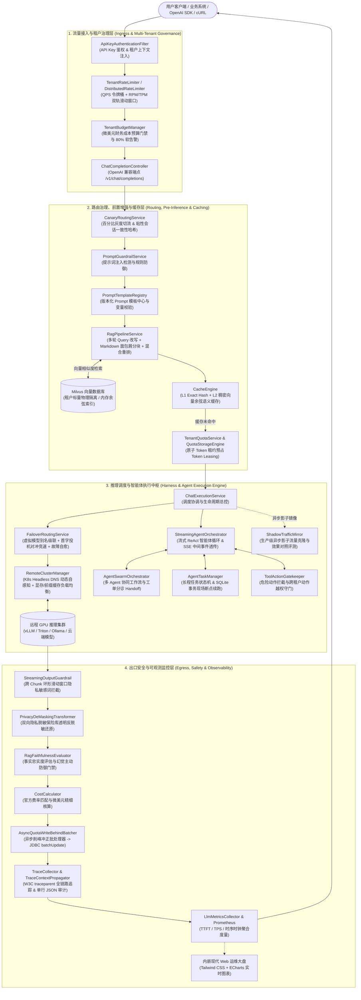
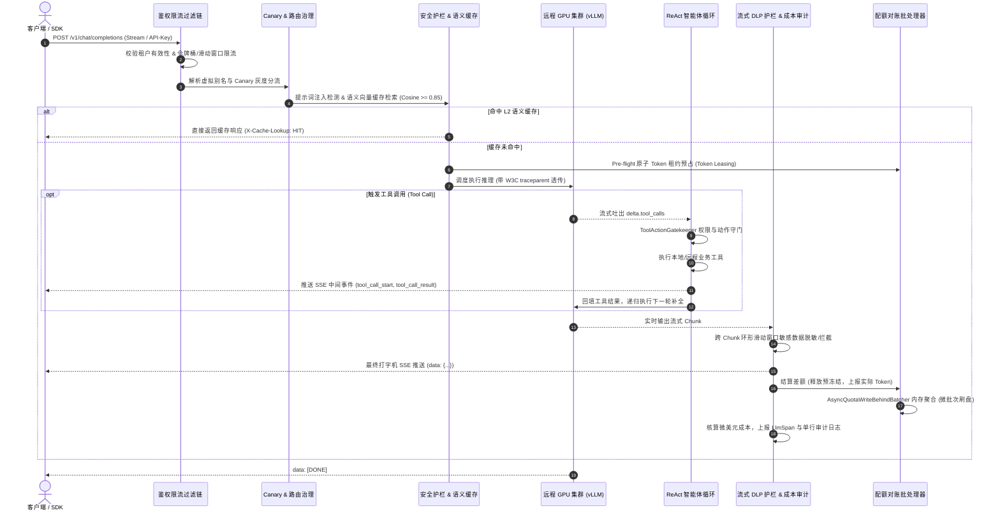

# 系统架构与模块设计 (System Architecture & Module Design)

本文档深入解析 **LLM Enterprise Hub** 的系统分层架构、运行时拓扑、多模块工程关系以及端到端请求生命周期。

> 💡 **宏观分层与上下游协同**：关于本项目在全行业大模型在线服务 4 层体系中的宏观位置、同类竞品边界及上下游框架协同机制，请先参阅：[LLM 在线服务全景生态定位与协同白皮书 (ecosystem-positioning.md)](ecosystem-positioning.md)。

---

## 一、系统架构全景图

系统基于 **Java 21 虚拟线程 (Virtual Threads)** 构建高吞吐、低延迟的非阻塞核心底座，在网关层完全兼容 **OpenAI 标准协议**，将大模型治理流程抽象为四个清晰阶段：



---

## 二、工程多模块拓扑与职责划分

本项目采用严格分层的 Maven 多模块架构，核心业务、脚手架装配、独立服务与示例工程高度解耦：

```
llm-enterprise-hub/
├── llm-enterprise-core/                # 核心引擎层 (纯业务领域模型与核心算法，无外部胖容器依赖)
├── llm-enterprise-spring-boot-starter/ # 开箱即用 Starter (自动化配置、@LlmTool 扫描、依赖装配)
├── llm-enterprise-gateway-server/      # 独立网关服务端 (可直接部署的完整微服务网关应用)
└── samples/
    └── sample-business-app/            # 企业级业务示例工程 (演示 Starter 接入与 @LlmTool 注册)
```

### 1. `llm-enterprise-core` (核心引擎模块)
- **定位**：纯净的 Java 21 领域内核，定义大模型治理、智能体编排与流量治理的标准契约与核心算法；
- **核心包结构**：
  - `client/`：统一 LLM 客户端抽象接口 (`LlmClient`)、SSE 流式处理器 (`StreamCancellationHandle`)；
  - `model/`：OpenAI 标准请求响应模型 (`ChatCompletionRequest`, `ChatCompletionResponse`, `ChatMessage`, `Usage` 等)；
  - `router/`：多级故障转移 (`FailoverRoutingService`)、投机对冲竞速 (`RequestHedgingRouter`)、虚拟模型别名 (`ModelAliasRegistry`)；
  - `router/canary/`：Canary 灰度切流引擎与粘性会话一致性哈希 (`CanaryRoutingService`, `CanaryRule`)；
  - `router/shadow/`：生产级异步影子流量镜像与对照审计 (`ShadowTrafficMirror`, `ShadowComparisonRecord`)；
  - `cluster/`：远程 GPU 集群拓扑自感知 SPI (`ClusterDiscoveryProvider`)、显存与前缀缓存哈希负载均衡 (`ClusterLoadBalancer`)、多 Key 轮转凭据池 (`ApiKeyPool`)；
  - `quota/`：租户配额治理服务 (`TenantQuotaService`)、无锁 CAS 预占与 Redis Lua 租约引擎 (`QuotaStorageEngine`, `DistributedLuaQuotaEngine`)、异步削峰写回批处理器 (`AsyncQuotaWriteBehindBatcher`)；
  - `ratelimit/`：QPS 令牌桶 (`TenantRateLimiter`)、毫秒槽双轨滑动窗口 (`SlidingWindowRateLimiter`)、带本地熔断降级的分布式限流器 (`DistributedRateLimiter`)；
  - `cost/`：企业级模型费率注册表 (`ModelPricingRegistry`)、微美元成本核算器 (`CostCalculator`)、租户财务预算管理器 (`TenantBudgetManager`)；
  - `guard/`：入站提示词注入防御 (`PromptGuardrailService`)、出站正则数据脱敏 (`OutputGuardrailService`)、流式跨 Chunk 环形滑动窗口拦截器 (`StreamingOutputGuardrail`)、双向脱敏隐私保险库 (`PrivacyVault`)、工具越权动作守门员 (`ToolActionGatekeeper`)；
  - `cache/`：L1 Exact Hash 精准匹配 + L2 稠密向量余弦相似度语义缓存引擎 (`CacheEngine`, `CacheEntry`)；
  - `agent/`：ReAct 循环工具调度器 (`AgentToolOrchestrator`)、流式智能体生命周期中间事件透传 (`StreamingAgentOrchestrator`)、多 Agent 协同分诊工作流 (`AgentSwarmOrchestrator`)、长程状态机与检查点恢复 (`AgentTaskManager`)；
  - `rag/`：前置 RAG 检索增强服务 (`RagPipelineService`)、Markdown 章节层级分块器 (`MarkdownStructureChunker`)、多轮指代消解 Query 改写器 (`ContextualQueryRewriter`)、混合检索重排序器 (`HybridSearchReranker`)、事实忠实度评估防御 (`RagFaithfulnessEvaluator`)；
  - `template/`：Prompt 模板引擎 (`PromptTemplateEngine`)、版本化与多租户定制 Prompt 模板中心 (`PromptTemplateRegistry`)；
  - `resilience/`：自愈型三态熔断器 (`CircuitBreaker`)、AWS/Envoy 标准 Full Jitter 指数退避重试器 (`AdaptiveJitteredRetryPolicy`)；
  - `trace/`：全链路 Trace 上下文管理器 (`TraceContext`)、W3C 标准协议传递器 (`TraceContextPropagator`)、结构化调用链与单行标准 JSON 审计打点器 (`TraceCollector`, `RequestAuditLogger`)。

### 2. `llm-enterprise-spring-boot-starter` (自动化装配模块)
- **定位**：为企业微服务赋能的 Spring Boot 3.3 Starter；
- **核心能力**：
  - 自动扫描 Spring 容器中带有 `@LlmTool` 注解的业务 Bean 方法，通过反射与类型推断自动生成标准的 OpenAI JSON Schema 并注册到工具注册表 (`ToolRegistry`)；
  - 自动配置所有的网关治理 Bean（条件装配 `@ConditionalOnMissingBean`），方便业务随时按需替换自定义 SPI 扩展；
  - 支持业务微服务以极低侵入度（仅需声明依赖）实现与 Hub 网关的一体化协同或进程内直接运行。

### 3. `llm-enterprise-gateway-server` (独立网关服务模块)
- **定位**：企业内网独立运行的集中式大模型 API 网关微服务；
- **包含组件**：
  - OpenAI 兼容的 HTTP 接入端点 (`ChatCompletionController`)；
  - SQLite WAL 模式轻量持久化与元数据仓储 (`TenantRepository`, `SqliteSessionStorageProvider`, `SqliteAgentTaskStorageProvider`)；
  - 内嵌现代 Web 运维大盘控制台（静态资源零外部 CDN 依赖，Tailwind CSS + ECharts 实时渲染）；
  - 租户管理与运营大盘 REST API (`AdminController`, `KnowledgeBaseController`, `AgentTaskController`, `SessionController`)。

### 4. `samples/sample-business-app` (业务示例模块)
- **定位**：展示真实企业业务系统如何无缝接入 Starter 的参考实现；
- **典型场景**：
  - 演示真实订单查询 (`queryOrderStatus`) 与运费试算 (`calculateShippingFee`) 业务接口标注 `@LlmTool`；
  - 演示多 Agent 协同工单分诊流转（TriageAgent -> LogisticsAgent）。

---

## 三、请求完整执行时序 (Lifecycle Sequence)

以下为一次带有智能体工具调用、缓存检测与流式输出的完整请求生命周期时序：



---

## 四、虚拟线程与高并发模型 (Concurrency Model)

系统全链路基于 **Java 21 Virtual Threads (Project Loom)** 构建：
1. **轻量与百万级并发**：每个入站 HTTP 请求在专属虚拟线程中执行，底层线程栈仅占用几百字节，完全摆脱传统 Tomcat/Netty 平台线程池耗尽导致的请求排队卡死；
2. **非阻塞式 I/O 链路**：
   - 向下游远程推理集群 (vLLM/Triton) 发送 HTTP 同步或流式请求时，虚拟线程自动挂起 Carrier 载体线程，让出 CPU 核心给其他计算任务；
   - 影子流量镜像 (`ShadowTrafficMirror`) 采用 `Executors.newVirtualThreadPerTaskExecutor()` 实现并发异步克隆，做到对主链路绝对的零延迟与零穿透；
   - 智能体工具执行 (`AgentToolOrchestrator`) 对无依赖的多个并发 Tool Calls 使用虚拟线程并行触发，大幅压缩多工具调用的总端到端耗时。
