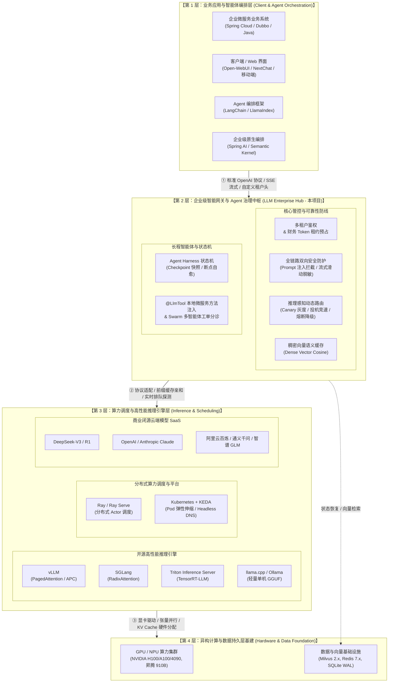
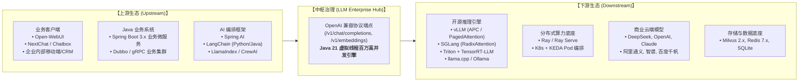
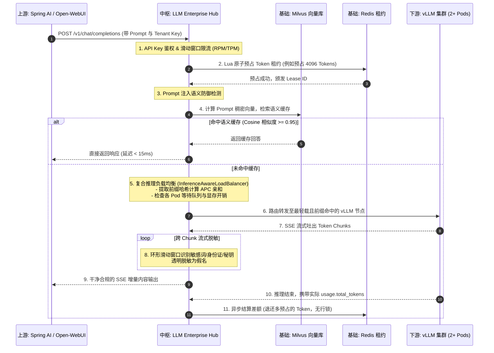
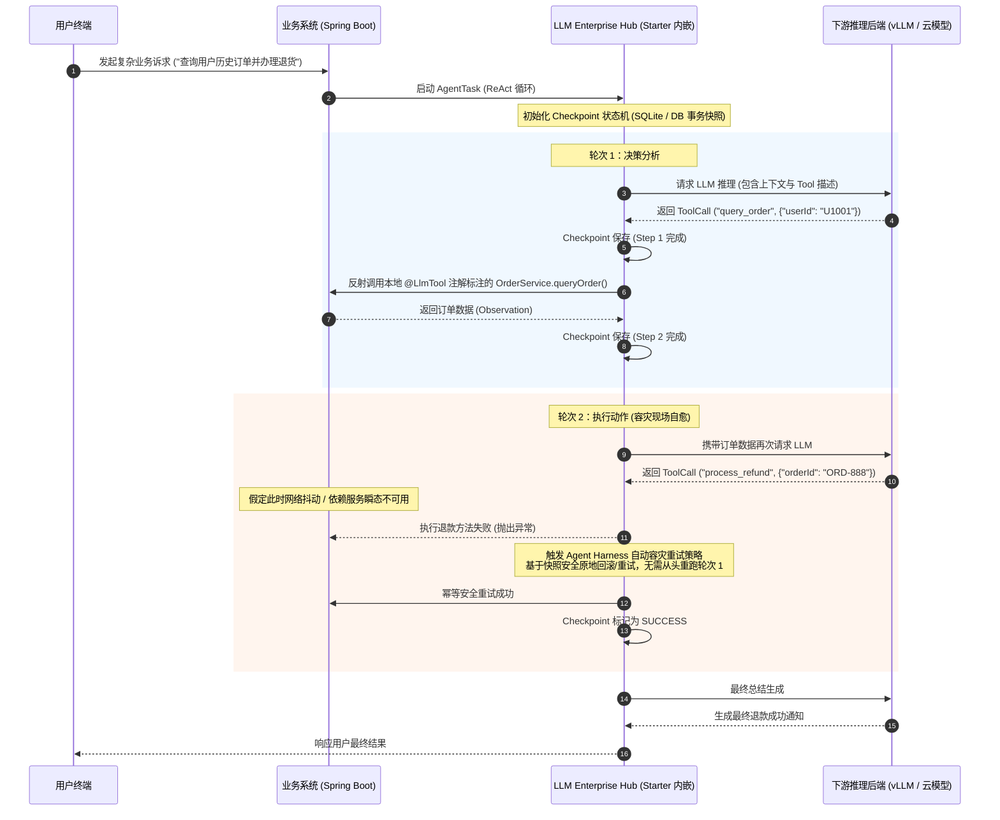
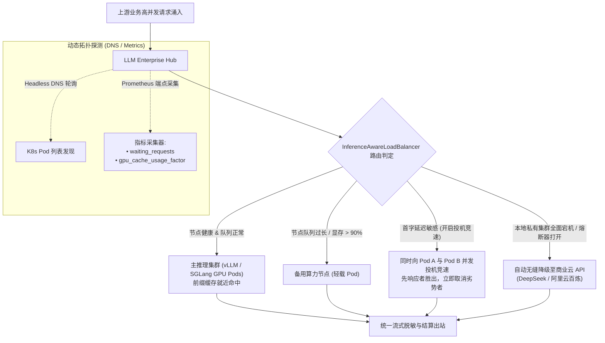

# LLM 在线服务全景生态定位与上下游协同白皮书 (Ecosystem Positioning & Integration Guide)

---

## 📑 目录

- [一、宏观全景分层架构 (Macro Architecture & Layering)](#一宏观全景分层架构-macro-architecture--layering)
- [二、LLM Enterprise Hub 所处层级与核心价值](#二llm-enterprise-hub-所处层级与核心价值)
- [三、同类竞品横向定位与能力对比](#三同类竞品横向定位与能力对比)
- [四、上下游主流开源框架全景](#四上下游主流开源框架全景)
- [五、各层开源框架之间如何协同配合 (End-to-End Collaboration)](#五各层开源框架之间如何协同配合-end-to-end-collaboration)
- [六、企业生产级落地部署拓扑推荐](#六企业生产级落地部署拓扑推荐)

---

## 一、宏观全景分层架构 (Macro Architecture & Layering)

在大模型从「单机实验/Prompt 调用」走向「大规模生产落地」的演进历程中，现代企业级 AI 在线服务体系已经沉淀出清晰的 **四层解耦架构**：

---

## 二、LLM Enterprise Hub 所处层级与核心价值

### 1. 明确层级位置
**LLM Enterprise Hub 坚定处于「第 2 层：企业级智能网关与 Agent 治理中枢」**。

它**不是**底层的模型算子加速器（不做 CUDA 核函数优化、不重复造 vLLM 的 PagedAttention 轮子），也**不是**面向最终用户的低代码可视化托拉拽画板（不与 Dify / FastGPT 争夺前端界面生态）。

它是整个体系中的 **企业级核心承重墙** 与 **中枢路由器**：
- **向上承接**：所有企业业务微服务、移动客户端以及 LangChain/Spring AI 等编排框架；
- **向下管控**：纳管私有部署的开源推理集群（vLLM、SGLang、Triton、Ray）、单机轻量引擎（llama.cpp、Ollama）以及外部公有云大模型 API。

### 2. 为什么不可或缺？（填补的结构性断层）
若没有这层网关中枢，直接让上层业务应用对接底层推理集群，企业会立即陷入以下 5 大生产级陷阱：
1. **配额与财务失控**：大模型生成消耗完全动态，上层无法预判 Token 数量。并发涌入时，简易后置扣费直接击穿额度，而直接更新数据库热行又会引发严重行锁死锁；
2. **长程 Agent 脆弱易碎**：Agent 往往涉及 10+ 步工具调用。如果底层偶发网络超时或某工具崩溃，前置数万 Token 交互直接丢失，缺乏事务快照与断点续跑能力；
3. **数据出海与出厂安全裸奔**：企业出站内容多为 SSE 字符流，敏感词往往被拆碎在两个相邻 Chunk 跨包传输，传统的反向代理根本无法做跨分块正则拼装与脱敏；
4. **底层算力资源利用率低下**：通用 7 层代理（如 Nginx）只能按 TCP/HTTP 连接轮询，不知道 vLLM 正在排队的请求数（`waiting_requests`），也不知道某个节点上已缓存了该 Prompt 的前缀（Prefix Caching），导致热点集中或缓存屡屡未命中；
5. **Java 企业生态严重割裂**：市面开源网关多为 Python 或 Go 开发，无法直接利用 Java 强类型体系将企业已有的 Spring `@Service` 业务方法自动暴露为 Tool。

---

## 三、同类竞品横向定位与能力对比

在整个大模型软件技术栈中，存在多个形态各异的相关项目。各项目的核心分工与边界如下：

| 竞品项目 | 所处层级 | 典型代表定位 | 与 LLM Enterprise Hub 的核心差异与分工 |
| :--- | :--- | :--- | :--- |
| **One-API / New-API** | 第 2 层 (轻量) | **商业 API 聚合转售与号池分发器** | **定位不同**。One-API 专注于聚合海量第三方 API 账号并做转售计费；**Hub 专注于企业内部生产级治理**（Java 21 虚拟线程原生、三层 Token 租约、跨 Chunk 流式脱敏、Agent 状态机、私有推理感知）。 |
| **LiteLLM (Proxy)** | 第 2 层 (轻量) | **Python 轻量 SDK 与代理层** | **语言与交付形态不同**。LiteLLM 适合 Python 单体应用或快速脚本；**Hub 面向 Java/Spring 企业级中台生态**，支持独立网关或无缝嵌入已有微服务（Starter 零侵入引入），并具备事务级持久化。 |
| **Kong / Envoy AI Gateway** | 第 2 层 (网络层) | **云原生网络反向代理与插件** | **抽象粒度不同**。Kong/Envoy 偏向 4/7 层底层流量网络防护；**Hub 是业务感知型中枢**，深入到 Prompt 语义解析、稠密向量语义缓存、长程 Agent 状态机与 Spring `@LlmTool` 注入。 |
| **Dify / FastGPT** | 第 1 层 (应用层) | **低代码/无代码可视化 AI 平台** | **上下游互补关系**。Dify 提供面向运营与业务人员的 UI 画板；**Hub 可作为 Dify 的统一后端网关**，为 Dify 提供企业级的私有算力调度、高并发 Token 租约预占与敏感数据保险库。 |
| **vLLM / SGLang / Triton** | 第 3 层 (算力引擎) | **底层模型推理与显存加速器** | **上下游协同关系**。它们是底层高性能动力引擎，Hub 是车辆的智能驾驶舱与变速箱。Hub 通过专有适配器动态采集它们的排队深度与 KV Cache，实现前缀亲和负载调度。 |
| **Ray / Ray Serve** | 第 3 层 (算力调度) | **分布式通用 Python 计算框架** | **分工配合关系**。Ray 擅长 Python 异构多节点 Actor 编排与 GPU 资源调度；Hub 作为上层高吞吐网关对接 Ray Ingress，完成前置鉴权、安全护栏、语义缓存与降级重试。 |
| **Langfuse / Helicone** | 贯穿层 (可观测) | **大模型后置可观测与评估平台** | **协同互补关系**。Langfuse 侧重事后 Trace 收集、Bad Case 标注与成本报表；Hub 侧重**实时流量管控、在途请求拦截、自愈容灾与动态调度**。 |

---

## 四、上下游主流开源框架全景

LLM Enterprise Hub 具备标准协议开放性与零侵入适配能力，在上游与下游均拥有丰富的生态配合对象：

### 1. 上游对接标准（输入端）
- **通用接入**：原生兼容 **OpenAI RESTful API 与 SSE (Server-Sent Events) 流式协议**。任何支持配置 `OPENAI_BASE_URL` 与 `OPENAI_API_KEY` 的开源框架或商业应用，无需修改任何代码，仅需变更 Base URL 即可无缝切换接入；
- **企业扩展头传递**：
  - `X-Tenant-ID`：多租户物理/逻辑隔离标识；
  - `X-Session-ID`：粘性会话路由与长程交互跟踪标识；
  - `traceparent`：W3C 规范分布式全链路跟踪上下文。

### 2. 下游纳管标准（输出端）
- **动态可插拔适配器体系 (`InferenceBackendAdapter`)**：
  - `DIRECT`：针对原生 OpenAI 协议端点、本地独立部署模型或公有云 SaaS；
  - `VLLM`：接入专有 `/metrics` 与 `/health`，自动解析 `vllm:num_requests_waiting`、`vllm:gpu_cache_usage_factor`，提取 Prompt 命中 Prefix Caching；
  - `SGLang`：适配 SGLang 的 RadixAttention 树状缓存亲和调度与指标透传；
  - `TRITON`：适配 KServe v2 协议探活与并发度采集；
  - `RAY`：适配 Ray Serve Ingress 转发与探活。

---

## 五、各层开源框架之间如何协同配合 (End-to-End Collaboration)

### 场景一：典型在线高并发推理请求（上游编排 + Hub 治理 + 下游 vLLM 算力池）

---

### 场景二：长程自主智能体与本地方法协同（Agent Harness + Spring Boot 微服务）

---

### 场景三：推理集群异构调度与弹性自愈（K8s + vLLM/SGLang + 云端 API 降级对冲）

---

## 六、企业生产级落地部署拓扑推荐

根据企业规模与基础设施现状，推荐以下三种经典搭配形态：

### 形态 1：中小企业 / 纯商业云 API 统一网关形态
- **上游**：公司内所有产品线微服务、Chat Web 客户端。
- **中枢**：部署 2 节点 `LLM Enterprise Hub`，启用 `gateway` Profile。
- **下游**：直连 DeepSeek-V3、OpenAI、阿里云通义千问等商业 API。
- **配合价值**：统一多租户 API Key 授权、统一各部门 Token 财务核算与租约管控、跨部门出站数据合规脱敏、多模型自动容灾降级。

### 形态 2：私有化智算中心 / vLLM + K8s 集群形态
- **上游**：内部知识库（RAG 系统）、智能客服、企业内部 Copilot 插件。
- **中枢**：部署 `LLM Enterprise Hub` 集群，启用 `distributed` Profile，挂接 Milvus 与 Redis。
- **下游**：K8s 托管的 10~50 节点 vLLM / SGLang Pods（搭载 H100 / A100 / 4090 卡）。
- **配合价值**：动态 Headless DNS Pod 发现、前缀缓存亲和调度大幅削减首字延迟、实时排队深度感知防止雪崩、稠密语义缓存节省大量算力。

### 形态 3：边缘节点 / 离线机房 / 个人开发单机形态
- **架构**：单台主机运行 `LLM Enterprise Hub`，启用 `standalone` Profile。
- **配合方式**：Hub 内置 `EmbeddedLocalEngineSupervisor`，自动调用本地已安装的 `llama-server` 或 `ollama serve` 二进制程序管理本地模型（GGUF 格式）；持久化采用内置 SQLite WAL 模式，向量检索退避为纯内存余弦匹配。
- **配合价值**：**0 外部中间件依赖**，单 Jar 包即构成集模型运行、网关反代、租户管理、Web 看板于一体的完整微型服务闭环。

---

> 进一步了解细节：  
> - 核心系统架构说明：[系统架构设计 (docs/architecture.md)](architecture.md)  
> - 三大部署形态实战手册：[三大部署形态手册 (docs/deployment-modes.md)](deployment-modes.md)  
> - 多推理后端可插拔开发指南：[多推理后端适配 (docs/pluggable-inference-backend.md)](pluggable-inference-backend.md)  
