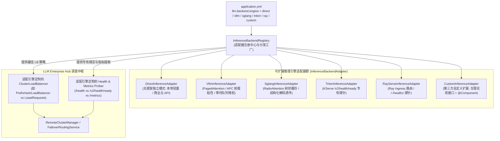

# 可插拔推理后端与多引擎适配指南 (Pluggable Inference Backend Guide)

LLM Enterprise Hub 采用策略模式（Strategy Pattern）与可插拔服务提供者接口（SPI），实现了对**无框架独立模式（DIRECT）**与**分布式/高性能深度推理框架（vLLM、SGLang、Triton、Ray Serve）**的配置化解耦与无缝切换。同时支持第三方开发者以零侵入方式快速扩展任意自研或新兴推理引擎。

---

## 目录导航

- [一、核心架构与扩展设计](#一核心架构与扩展设计)
- [二、配置驱动：一键切换后端引擎](#二配置驱动一键切换后端引擎)
- [三、内置五大标准推理引擎适配器](#三内置五大标准推理引擎适配器)
  - [1. 无框架独立模式 (DIRECT)](#1-无框架独立模式-direct)
  - [2. vLLM 专有适配器 (VLLM)](#2-vllm-专有适配器-vllm)
  - [3. SGLang 专有适配器 (SGLANG)](#3-sglang-专有适配器-sglang)
  - [4. Triton 专有适配器 (TRITON)](#4-triton-专有适配器-triton)
  - [5. Ray Serve 专有适配器 (RAY)](#5-ray-serve-专有适配器-ray)
- [四、实战：如何编写一个自定义扩展适配器 (Custom Extension)](#四实战如何编写一个自定义扩展适配器-custom-extension)
- [五、背压自适应流控与过载保护机制](#五背压自适应流控与过载保护机制)

---

## 一、核心架构与扩展设计

系统将网关治理调度与具体推理后端的协议差异、健康探针、负载均衡策略全面抽象：



### 核心设计原则
1. **开闭原则 (Open-Closed Principle)**：新增推理引擎无需修改网关核心调度逻辑与时序；
2. **渐进式演进**：开发和离线测试时使用 `direct`（无框架模式，单机零外部依赖）；业务上量时只需修改一行配置即可切到 `vllm` 或 `ray` 集群；
3. **节点级细粒度控制**：支持全局默认引擎与单节点 `engineType` 混合部署（例如主推节点用 vLLM，备用节点用 SGLang，熔断兜底用 Direct 本地模型）。

---

## 二、配置驱动：一键切换后端引擎

在 `application.yml` 中，通过 `llm.backend.engine` 声明激活的后端类型：

```yaml
llm:
  # ----------------------------------------------------------------------------
  # 推理后端引擎选择：
  # 可选值：
  #   - direct (默认：无框架独立模式，适合本地 Ollama/llama.cpp/商业云端 OpenAI API)
  #   - vllm   (vLLM 专有后端：APC 前缀缓存一致性调度、/health 探活、/metrics 背压)
  #   - sglang (SGLang 专有后端：RadixAttention 树状缓存亲和、/health 探活)
  #   - triton (Triton 专有后端：KServe v2 /v2/health/ready 探活、TRT-LLM 批处理适配)
  #   - ray    (Ray Serve 专有后端：Ray Ingress 路由、/-/healthz 探活)
  #   - custom (或任意自定义第三方适配器标识)
  # ----------------------------------------------------------------------------
  backend:
    engine: "direct"                    # 默认无框架独立运行
    max-waiting-requests: 20            # 后端推理等待队列过载门禁阈值
    max-gpu-cache-usage: 0.95           # GPU KV-Cache 显存饱和阈值 (95%)
```

---

## 三、内置五大标准推理引擎适配器

### 1. 无框架独立模式 (DIRECT)
- **标识代码**：`direct`
- **实现类**：`DirectInferenceAdapter`
- **适用场景**：
  - 开发者本地环境；
  - 边缘单机设备或内网离线机房；
  - 直接调用商业公有云（DeepSeek、阿里云通义千问、OpenAI、月之暗面等）；
- **探活协议**：探测 `${baseUrl}/models` 或 `${baseUrl}/v1/models`；
- **负载均衡**：默认采用 `LeastRequestsLoadBalancer`（最小活跃请求数），保障各节点并发压力均衡。

### 2. vLLM 专有适配器 (VLLM)
- **标识代码**：`vllm`
- **实现类**：`VllmInferenceAdapter`
- **核心机制**：
  - **APC (Automatic Prefix Caching) 亲和调度**：默认采用 `PrefixHashLoadBalancer`，相同 Prompt 前缀（System Prompt 或多轮上下文）始终路由到相同的 vLLM 实例，KV 缓存复用率提升 60%~80%，显著降低首字延迟（TTFT）；
  - **专有探活**：优先探测 `${rootUrl}/health`，异常时平滑退避探测 `/v1/models`；
  - **背压指标自省**：自动解析 `/metrics` 中的 `vllm:num_requests_waiting` 与 `vllm:gpu_cache_usage_factor`。

### 3. SGLang 专有适配器 (SGLANG)
- **标识代码**：`sglang`
- **实现类**：`SglangInferenceAdapter`
- **核心机制**：
  - **RadixAttention 树状缓存复用**：针对多轮复杂 Agent 与树状分叉对话，采用确定性前缀哈希，使子对话精准击中已有 Radix 缓存分支；
  - **专有探活**：探测 `${rootUrl}/health`；
  - **背压指标自省**：自动解析 `/metrics` 中的 `sglang:num_waiting_reqs` 与 `sglang:gpu_cache_usage`。

### 4. Triton 专有适配器 (TRITON)
- **标识代码**：`triton`
- **实现类**：`TritonInferenceAdapter`
- **核心机制**：
  - **KServe v2 协议探针**：探测 `${rootUrl}/v2/health/ready`（模型就绪状态）与 `/v2/health/live`；
  - **负载均衡**：默认使用动态并发平衡调度。

### 5. Ray Serve 专有适配器 (RAY)
- **标识代码**：`ray`
- **实现类**：`RayServeInferenceAdapter`
- **核心机制**：
  - **Ray Ingress 路由**：对接 Ray Serve Controller 暴露的聚合端点；
  - **专有探活**：探测 `${rootUrl}/-/healthz` 与 `/-/routes`。

---

## 四、实战：如何编写一个自定义扩展适配器 (Custom Extension)

若要引入新的推理引擎（例如 **TGI (Text Generation Inference)** 或 **自研高性能推理网关**），只需实现 `InferenceBackendAdapter` 接口，并标注 `@Component`：

```java
package com.enterprise.llm.custom;

import com.enterprise.llm.backend.InferenceBackendAdapter;
import com.enterprise.llm.cluster.UpstreamNode;
import com.enterprise.llm.cluster.lb.ClusterLoadBalancer;
import com.enterprise.llm.cluster.lb.LeastRequestsLoadBalancer;
import com.enterprise.llm.model.ChatCompletionRequest;
import org.springframework.stereotype.Component;

import java.net.URI;
import java.net.http.HttpClient;
import java.net.http.HttpRequest;
import java.net.http.HttpResponse;
import java.time.Duration;

/**
 * 自定义 TGI (Text Generation Inference) 适配器示例
 */
@Component
public class TgiInferenceAdapter implements InferenceBackendAdapter {

    @Override
    public String getEngineType() {
        return "tgi"; // 引擎标识，对应 yml 中的 llm.backend.engine=tgi
    }

    @Override
    public ClusterLoadBalancer createDefaultLoadBalancer() {
        return new LeastRequestsLoadBalancer();
    }

    @Override
    public boolean checkHealth(UpstreamNode node, HttpClient httpClient) {
        HttpClient client = httpClient != null ? httpClient : HttpClient.newHttpClient();
        try {
            HttpRequest request = HttpRequest.newBuilder()
                    .uri(URI.create(node.getBaseUrl() + "/health"))
                    .timeout(Duration.ofSeconds(3))
                    .GET()
                    .build();
            HttpResponse<Void> response = client.send(request, HttpResponse.BodyHandlers.discarding());
            return response.statusCode() == 200;
        } catch (Exception e) {
            return false;
        }
    }

    @Override
    public void extractMetrics(UpstreamNode node, String prometheusText) {
        // 解析 TGI 专有的 tgi_request_count 等指标...
    }

    @Override
    public ChatCompletionRequest adaptRequest(ChatCompletionRequest request, UpstreamNode node) {
        // 可选：在此处为 TGI 注入特定 HTTP Header 或结构化参数
        return request;
    }
}
```

网关启动时，`InferenceBackendRegistry` 会自动发现并注册该适配器。只需在配置文件中指定即可无缝生效：
```yaml
llm:
  backend:
    engine: "tgi"
```

---

## 五、背压自适应流控与过载保护机制

在生产级自建 GPU 推理集群下，节点发生过载时，HTTP 端口往往仍然是连通的（返回 200），但其 GPU 显存已被耗尽，或者内部等待队列堆积了数十个请求。如果继续盲目路由请求，会导致：
1. 请求首字延迟暴增至数十秒；
2. 触发 CUDA OOM 导致推理引擎崩溃重启；
3. 引发连锁雪崩。

LLM Enterprise Hub 的 `UpstreamNode` 与适配器协同工作，实现了**显存背压自适应保护**：
```java
// 检查节点是否处于排队过载或显存耗尽状态
boolean overloaded = node.isOverloaded(
    properties.getMaxWaitingRequests(), // 例如 20
    properties.getMaxGpuCacheUsage()    // 例如 0.95 (95%)
);
```
当节点被判定为 `isOverloaded()` 时，负载均衡器会自动降低该节点权重或临时跳过，平滑转移流量至其余算力节点或本地兜底模型，确保企业级大模型应用在极限大促与流量洪峰下稳如磐石。
