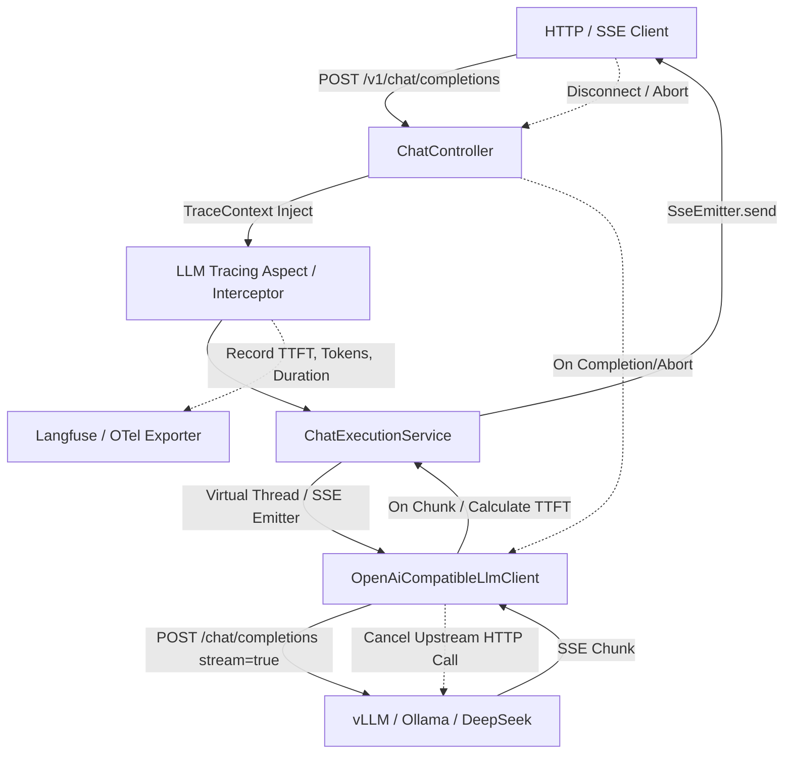

# Phase 1: LLM-Enterprise-Hub Infrastructure, Streaming & Tracing Implementation Plan

> **For agentic workers:** REQUIRED SUB-SKILL: Use superpowers:subagent-driven-development to implement this plan task-by-task. Steps use checkbox (`- [ ]`) syntax for tracking.

**Goal:** Build the core execution foundation for `llm-enterprise-hub` in Java 21 & Spring Boot 3, featuring OpenAI-compatible LLM client abstraction, high-concurrency SSE streaming with client-abort cancellation, and OpenTelemetry/Langfuse distributed tracing.

**Architecture:** A lightweight modular architecture on Spring Boot 3 + Java 21 Virtual Threads. Incoming chat requests flow through `TraceInterceptor` into `ChatService`, which invokes an OpenAI-compatible `LlmClient` streaming provider via reactive/SSE pipelines. When clients disconnect, active HTTP streaming connections are cancelled to avoid GPU resource wastage. All spans (request, provider call, streaming TTFT, token usage) are structured and exported to OpenTelemetry/Langfuse format.

**Architecture Diagram:**



**Tech Stack:** 
- Java 21 (Virtual Threads enabled: `spring.threads.virtual.enabled=true`)
- Spring Boot 3.3.x (Web, Jackson 2.17+)
- Maven Wrapper (`mvnw`)
- OpenTelemetry Java SDK / Micrometer Tracing
- JUnit 5 + AssertJ + MockWebServer (for streaming mock tests)

---

### Task 1: Project Scaffolding & Maven Wrapper Setup

**Files:**
- Create: `pom.xml`
- Create: `mvnw`
- Create: `.mvn/wrapper/maven-wrapper.properties`
- Create: `src/main/resources/application.yml`
- Create: `src/main/java/com/enterprise/llm/LlmEnterpriseHubApplication.java`
- Test: `src/test/java/com/enterprise/llm/LlmEnterpriseHubApplicationTests.java`

- [x] **Step 1: Create `pom.xml` with Spring Boot 3, Java 21, and dependencies**

Define dependencies: `spring-boot-starter-web`, `spring-boot-starter-validation`, `jackson-databind`, `junit-jupiter`, `assertj-core`, `mockwebserver`. Enable virtual threads in config.

- [x] **Step 2: Setup Maven Wrapper (`mvnw` and wrapper properties)**

Ensure `./mvnw clean test-compile` can run without a globally installed Maven by using Maven wrapper.

- [x] **Step 3: Write application entrypoint and smoke test**

```java
@SpringBootTest
class LlmEnterpriseHubApplicationTests {
    @Test
    void contextLoads() {}
}
```

- [x] **Step 4: Run test to verify application boots**

Run: `./mvnw test`
Expected: BUILD SUCCESS (1 test passed)

- [x] **Step 5: Git init & initial commit**

```bash
git init
git add .
git commit -m "chore: initialize llm-enterprise-hub with Java 21 and Spring Boot 3"
```

---

### Task 2: Standardized LLM Protocol Data Models & Error Handling

**Files:**
- Create: `src/main/java/com/enterprise/llm/model/ChatMessage.java`
- Create: `src/main/java/com/enterprise/llm/model/ChatCompletionRequest.java`
- Create: `src/main/java/com/enterprise/llm/model/ChatCompletionResponse.java`
- Create: `src/main/java/com/enterprise/llm/model/ChatCompletionChunk.java`
- Create: `src/main/java/com/enterprise/llm/model/Usage.java`
- Test: `src/test/java/com/enterprise/llm/model/ModelSerializationTest.java`

- [x] **Step 1: Write serialization/deserialization unit test for OpenAI SSE chunks**

Test parsing delta content, role, finish_reason, and usage stats from standard JSON strings.

- [x] **Step 2: Run test to verify failure**

Run: `./mvnw test -Dtest=ModelSerializationTest`
Expected: Compilation failure (classes not created yet)

- [x] **Step 3: Implement data models with Jackson annotations (SnakeCase naming strategy)**

Support `role`, `content`, `stream`, `temperature`, `model`, `usage` with `@JsonProperty` or `PropertyNamingStrategies.SNAKE_CASE`.

- [x] **Step 4: Run test to verify it passes**

Run: `./mvnw test -Dtest=ModelSerializationTest`
Expected: PASS

- [x] **Step 5: Commit**

```bash
git add src/
git commit -m "feat: add OpenAI compatible chat data models and serialization"
```

---

### Task 3: OpenAI-Compatible LLM Client & SSE Streaming Engine

**Files:**
- Create: `src/main/java/com/enterprise/llm/client/LlmClient.java`
- Create: `src/main/java/com/enterprise/llm/client/OpenAiCompatibleLlmClient.java`
- Create: `src/main/java/com/enterprise/llm/client/StreamCancellationHandle.java`
- Test: `src/test/java/com/enterprise/llm/client/OpenAiCompatibleLlmClientTest.java`

- [x] **Step 1: Write unit test using MockWebServer simulating SSE stream**

Simulate upstream server sending chunks:
`data: {"choices":[{"delta":{"content":"Hello"}}]}\n\ndata: {"choices":[{"delta":{"content":" world"}}]}\n\ndata: [DONE]\n\n`
Verify that `Consumer<ChatCompletionChunk>` receives both chunks in order, and cancellation stops further reads.

- [x] **Step 2: Run test to verify failure**

Run: `./mvnw test -Dtest=OpenAiCompatibleLlmClientTest`
Expected: Fail

- [x] **Step 3: Implement `OpenAiCompatibleLlmClient` using Java 21 `HttpClient` & Virtual Threads**

Implement line-by-line SSE parsing with `lines()`, handling `data: [DONE]`, calculating chunk arrival, and returning a `StreamCancellationHandle` which calls `CompletableFuture.cancel(true)` or closes the HTTP input stream.

- [x] **Step 4: Run test to verify passes**

Run: `./mvnw test -Dtest=OpenAiCompatibleLlmClientTest`
Expected: PASS

- [x] **Step 5: Commit**

```bash
git add src/
git commit -m "feat: implement OpenAiCompatibleLlmClient with streaming and cancel handle"
```

---

### Task 6: SSE Controller with Client-Abort Cancellation (Backpressure)

**Files:**
- Create: `src/main/java/com/enterprise/llm/service/ChatExecutionService.java`
- Create: `src/main/java/com/enterprise/llm/controller/ChatCompletionController.java`
- Test: `src/test/java/com/enterprise/llm/controller/ChatCompletionControllerTest.java`

- [x] **Step 1: Write integration test for SSE endpoint and disconnect handling**

Test `POST /v1/chat/completions`:
1. Request with `stream: true` returns `text/event-stream`.
2. Emulate client disconnect: trigger `ResponseBodyEmitter.onTimeout()` or `onError()` and verify `StreamCancellationHandle.cancel()` is invoked.

- [x] **Step 2: Run test to verify failure**

Run: `./mvnw test -Dtest=ChatCompletionControllerTest`
Expected: Fail

- [x] **Step 3: Implement `ChatExecutionService` and `ChatCompletionController`**

Use `ResponseBodyEmitter` / `SseEmitter`. Register `emitter.onCompletion()`, `emitter.onTimeout()`, and `emitter.onError()` to trigger upstream abort.

- [x] **Step 4: Run test to verify passes**

Run: `./mvnw test -Dtest=ChatCompletionControllerTest`
Expected: PASS

- [x] **Step 5: Commit**

```bash
git add src/
git commit -m "feat: add SSE chat completions controller with client-abort cancellation"
```

---

### Task 5: LLM Tracing & Metric Span Collection (TTFT, TPS, Langfuse-compatible)

**Files:**
- Create: `src/main/java/com/enterprise/llm/trace/TraceContext.java`
- Create: `src/main/java/com/enterprise/llm/trace/LlmSpan.java`
- Create: `src/main/java/com/enterprise/llm/trace/TraceCollector.java`
- Create: `src/main/java/com/enterprise/llm/trace/LangfuseTraceExporter.java`
- Test: `src/test/java/com/enterprise/llm/trace/LlmTracingTest.java`

- [x] **Step 1: Write test for calculating TTFT (Time-To-First-Token) and recording generation metrics**

Simulate: request arrives at T0, first chunk at T0 + 120ms, final token at T0 + 850ms, 100 output tokens.
Verify: `LlmSpan` accurately records `ttftMs = 120`, `totalLatencyMs = 850`, `tokensPerSecond = ~117.6`.

- [x] **Step 2: Run test to verify failure**

Run: `./mvnw test -Dtest=LlmTracingTest`
Expected: Fail

- [x] **Step 3: Implement `TraceContext`, `LlmSpan`, and `TraceCollector`**

Use ScopedValue or ThreadLocal for context propagation. Attach trace data to response headers or log events, and build export model conforming to Langfuse ingestion API.

- [x] **Step 4: Run test to verify passes**

Run: `./mvnw test -Dtest=LlmTracingTest`
Expected: PASS

- [x] **Step 5: Commit**

```bash
git add src/
git commit -m "feat: add LLM tracing with TTFT and token metrics collection"
```

---

### Task 6: End-to-End Verification & Documentation

**Files:**
- Create: `README.md`
- Create: `src/test/java/com/enterprise/llm/e2e/ChatStreamingE2ETest.java`

- [x] **Step 1: Write comprehensive End-to-End test suite**

Spin up embedded server with MockWebServer backend, send real HTTP POST, consume SSE chunks, verify trace output and header generation.

- [x] **Step 2: Run full build and test verification**

Run: `./mvnw clean verify`
Expected: All tests pass with zero errors.

- [x] **Step 3: Write industrial-grade README.md**

Document architecture, setup guide, curl examples for SSE streaming, and performance/cancellation design notes.

- [x] **Step 4: Final commit for Phase 1**

```bash
git add .
git commit -m "docs: add architecture documentation and finalize Phase 1 release"
```
