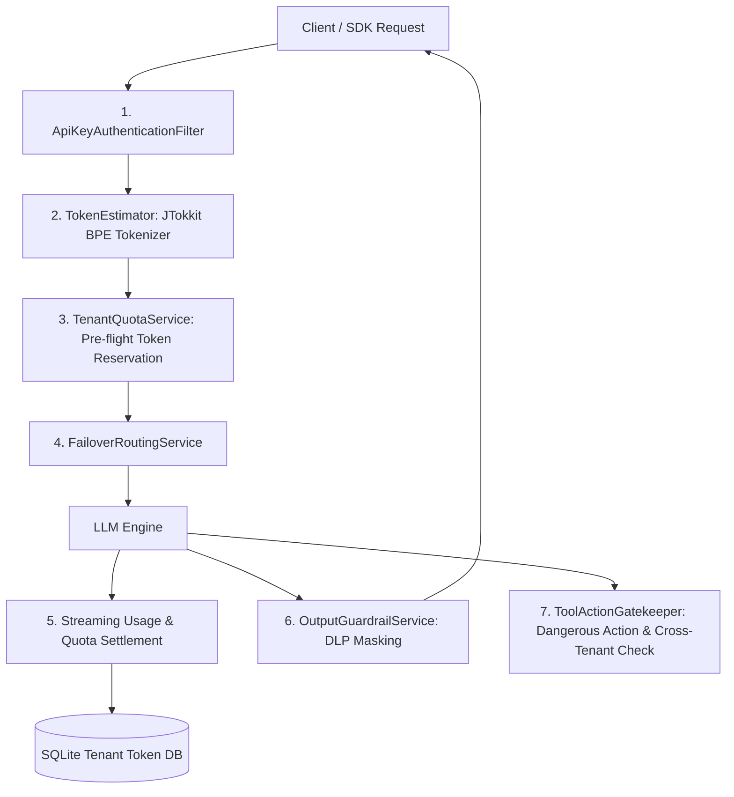

# Phase 3: Token Estimation, Quota Pre-Reservation, Output DLP & Action Gatekeeper Implementation Plan

> **For agentic workers:** REQUIRED SUB-SKILL: Use superpowers:subagent-driven-development to implement this plan task-by-task. Steps use checkbox (`- [ ]`) syntax for tracking.

**Goal:** Implement real-time token estimation, pre-flight reservation, streaming quota settlement, output DLP secret redaction, and tool action danger/cross-tenant gatekeeper.

**Architecture:**
Incoming requests are token-estimated via JTokkit BPE tokenizer and checked against the tenant's daily quota with pre-flight reservation. Streaming and sync executions track token usage and reconcile actuals against SQLite. Model responses pass through `OutputGuardrailService` for secret and PII redaction, while tool calls pass through `ToolActionGatekeeper` for safety and cross-tenant boundary validation.

**Architecture Diagram:**

**Tech Stack:**
- Java 21 + Spring Boot 3.3.4
- `com.knuddels:jtokkit:1.1.0` (BPE Tokenizer)
- SQLite JDBC (`org.xerial:sqlite-jdbc`) + Spring Data JDBC
- JUnit 5 + AssertJ + MockWebServer

---

### Task 1: Add JTokkit & Implement TokenEstimator

**Files:**
- Modify: `pom.xml` (add `jtokkit:1.1.0`)
- Create: `src/main/java/com/enterprise/llm/token/TokenEstimator.java`
- Test: `src/test/java/com/enterprise/llm/token/TokenEstimatorTest.java`

- [x] **Step 1: Add `jtokkit` to `pom.xml`**
- [x] **Step 2: Write unit test for `TokenEstimatorTest`**
- [x] **Step 3: Implement `TokenEstimator` using `EncodingType.CL100K_BASE`**
- [x] **Step 4: Run test to verify it passes**
- [x] **Step 5: Git commit**

---

### Task 2: Implement TenantQuotaService (Pre-flight Reservation & Settlement)

**Files:**
- Create: `src/main/java/com/enterprise/llm/quota/TenantQuotaService.java`
- Create: `src/main/java/com/enterprise/llm/quota/QuotaReservation.java`
- Create: `src/main/java/com/enterprise/llm/quota/QuotaExceededException.java`
- Test: `src/test/java/com/enterprise/llm/quota/TenantQuotaServiceTest.java`

- [x] **Step 1: Write unit test for reservation, exhaustion rejection, and settlement reconciliation**
- [x] **Step 2: Implement `TenantQuotaService` with atomic in-memory balances and DB persistence**
- [x] **Step 3: Run test to verify it passes**
- [x] **Step 4: Git commit**

---

### Task 3: Integrate Quota Reservation & Settlement into Chat Execution

**Files:**
- Modify: `src/main/java/com/enterprise/llm/service/ChatExecutionService.java`
- Modify: `src/main/java/com/enterprise/llm/controller/ChatCompletionController.java`
- Test: `src/test/java/com/enterprise/llm/quota/ChatQuotaIntegrationTest.java`

- [x] **Step 1: Write test for sync and streaming token reservation & settlement**
- [x] **Step 2: Integrate `TokenEstimator` and `TenantQuotaService` into `ChatCompletionController` and `ChatExecutionService`**
- [x] **Step 3: Run test to verify it passes**
- [x] **Step 4: Git commit**

---

### Task 4: Implement Output Safety & DLP Guardrail (OutputGuardrailService)

**Files:**
- Create: `src/main/java/com/enterprise/llm/guard/OutputGuardrailService.java`
- Test: `src/test/java/com/enterprise/llm/guard/OutputGuardrailServiceTest.java`

- [x] **Step 1: Write unit test for PII (phone, email) and secrets (OpenAI key, AWS key, JWT) redaction**
- [x] **Step 2: Implement `OutputGuardrailService` with pattern matching and `[REDACTED_*]` replacement**
- [x] **Step 3: Run test to verify it passes**
- [x] **Step 4: Git commit**

---

### Task 5: Implement Tool Action Gatekeeper (Dangerous Actions & Tenant Boundary)

**Files:**
- Create: `src/main/java/com/enterprise/llm/guard/ToolActionGatekeeper.java`
- Create: `src/main/java/com/enterprise/llm/guard/ToolAction.java`
- Create: `src/main/java/com/enterprise/llm/guard/CrossTenantViolationException.java`
- Test: `src/test/java/com/enterprise/llm/guard/ToolActionGatekeeperTest.java`

- [x] **Step 1: Write unit test for dangerous command blocking (rm -rf, drop table) and cross-tenant ID mismatch**
- [x] **Step 2: Implement `ToolActionGatekeeper`**
- [x] **Step 3: Run test to verify it passes**
- [x] **Step 4: Git commit**

---

### Task 6: Full Phase 3 E2E Integration & Verification

**Files:**
- Create: `src/test/java/com/enterprise/llm/e2e/Phase3GovernanceE2ETest.java`
- Modify: `README.md`

- [x] **Step 1: Write full E2E test verifying: Token Pre-reserve -> Streaming Settle -> Output DLP -> Tool Action Guardrail**
- [x] **Step 2: Run `./mvnw clean verify` across all tests**
- [x] **Step 3: Update `README.md` and commit Phase 3**
