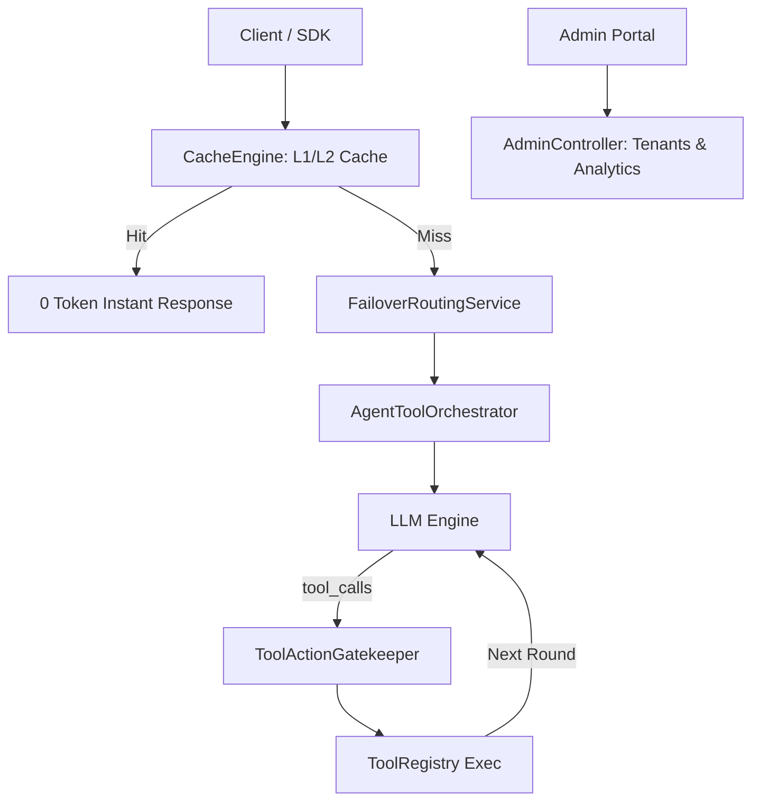

# Phase 4: Two-Level Cache, Admin Analytics API & Agent Tool Orchestration Implementation Plan

> **For agentic workers:** REQUIRED SUB-SKILL: Use superpowers:subagent-driven-development to implement this plan task-by-task. Steps use checkbox (`- [ ]`) syntax for tracking.

**Goal:** Implement Two-Level Semantic/Exact Cache Engine, Tenant Administration & Analytics REST API, and Automated Agent Tool Calling ReAct Orchestrator with security gatekeeper enforcement.

**Architecture:**
- Requests hit `CacheEngine` (L1 exact hash, L2 semantic similarity) before executing LLM. Cache hits return immediately with 0 tokens and track `savedTokens`.
- `AdminController` provides secure management endpoints protected by `X-Admin-Key` for tenant lifecycle and analytics overview.
- `AgentToolOrchestrator` inspects model tool calls, validates safety and tenant boundaries via `ToolActionGatekeeper`, executes tool handlers, and loops until final response.

**Architecture Diagram:**

**Tech Stack:**
- Java 21 + Spring Boot 3.3.4
- SQLite JDBC + Spring JDBC
- JUnit 5 + MockMvc + MockWebServer + AssertJ

---

### Task 1: Implement Two-Level Cache Engine (CacheEngine)

**Files:**
- Create: `src/main/java/com/enterprise/llm/cache/CacheProperties.java`
- Create: `src/main/java/com/enterprise/llm/cache/CacheEntry.java`
- Create: `src/main/java/com/enterprise/llm/cache/CacheEngine.java`
- Test: `src/test/java/com/enterprise/llm/cache/CacheEngineTest.java`

- [ ] **Step 1: Write unit test for L1 exact hit, L2 semantic hit, TTL expiry, and saved token stats**
- [ ] **Step 2: Implement `CacheProperties`, `CacheEntry`, and `CacheEngine`**
- [ ] **Step 3: Run test to verify it passes**
- [ ] **Step 4: Git commit**

---

### Task 2: Integrate CacheEngine into Chat Execution Pipeline

**Files:**
- Modify: `src/main/java/com/enterprise/llm/controller/ChatCompletionController.java`
- Modify: `src/main/java/com/enterprise/llm/service/ChatExecutionService.java`
- Test: `src/test/java/com/enterprise/llm/cache/ChatCacheIntegrationTest.java`

- [ ] **Step 1: Write integration test for sync cache hit and streaming SSE simulated playback**
- [ ] **Step 2: Update `ChatCompletionController` and `ChatExecutionService` to check cache first and populate cache on response**
- [ ] **Step 3: Run test to verify it passes**
- [ ] **Step 4: Git commit**

---

### Task 3: Implement Tenant Administration & Analytics Control Plane

**Files:**
- Create: `src/main/java/com/enterprise/llm/admin/AdminProperties.java`
- Create: `src/main/java/com/enterprise/llm/admin/AdminAnalyticsOverview.java`
- Create: `src/main/java/com/enterprise/llm/admin/AnalyticsService.java`
- Create: `src/main/java/com/enterprise/llm/admin/AdminController.java`
- Test: `src/test/java/com/enterprise/llm/admin/AdminControllerTest.java`

- [ ] **Step 1: Write controller test for tenant list, create, quota recharge, enable/disable, and analytics summary**
- [ ] **Step 2: Implement `AnalyticsService`, `AdminProperties`, and `AdminController` with `X-Admin-Key` verification**
- [ ] **Step 3: Run test to verify it passes**
- [ ] **Step 4: Git commit**

---

### Task 4: Implement Agent Tool Calling Orchestration & Safety Sandbox

**Files:**
- Create: `src/main/java/com/enterprise/llm/agent/ToolDefinition.java`
- Create: `src/main/java/com/enterprise/llm/agent/ToolRegistry.java`
- Create: `src/main/java/com/enterprise/llm/agent/AgentToolOrchestrator.java`
- Test: `src/test/java/com/enterprise/llm/agent/AgentToolOrchestratorTest.java`

- [ ] **Step 1: Write test for automated ReAct multi-round tool execution and Gatekeeper blocking**
- [ ] **Step 2: Implement `ToolRegistry` and `AgentToolOrchestrator`**
- [ ] **Step 3: Run test to verify it passes**
- [ ] **Step 4: Git commit**

---

### Task 5: Full Phase 4 E2E Integration & Verification

**Files:**
- Create: `src/test/java/com/enterprise/llm/e2e/Phase4EnterpriseE2ETest.java`
- Modify: `README.md`

- [ ] **Step 1: Write comprehensive E2E test verifying: Cache Hit -> Admin API -> Agent Tool Orchestration with Gatekeeper**
- [ ] **Step 2: Run `./mvnw clean verify` across all tests**
- [ ] **Step 3: Update `README.md` and commit Phase 4**
