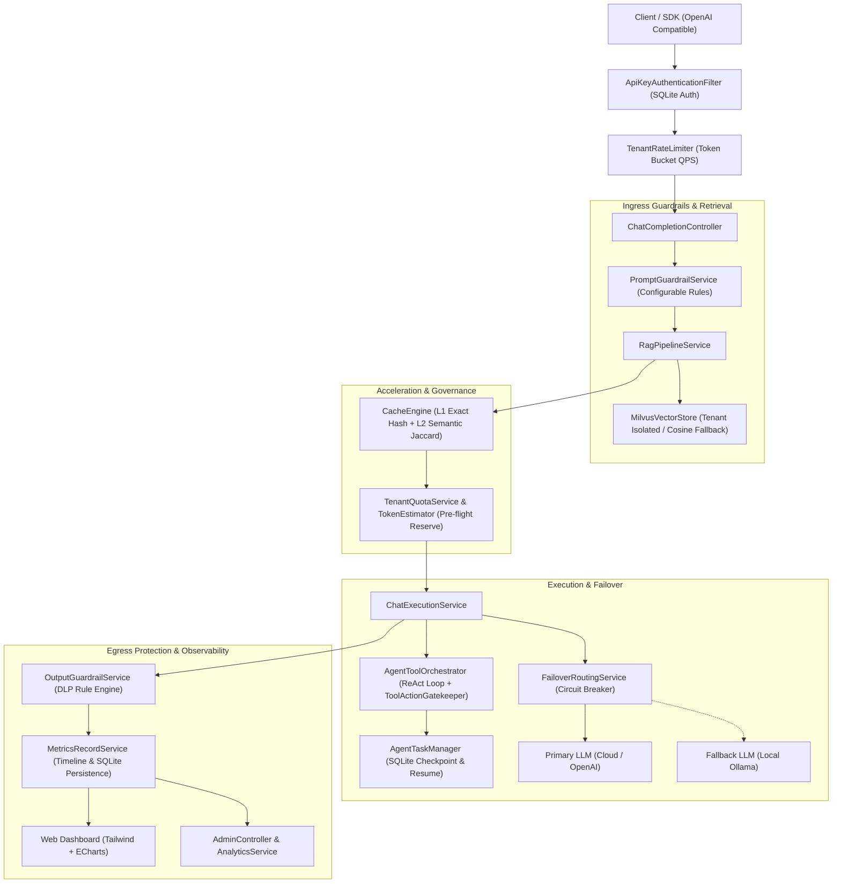

# 代码整体梳理、架构优化与企业级 README 规范化实施计划

> **For agentic workers:** REQUIRED SUB-SKILL: Use `superpowers:subagent-driven-development` to implement this plan task-by-task. Steps use checkbox (`- [ ]`) syntax for tracking.

**Goal:** 深度梳理 LLM-Enterprise-Hub 全量代码，消除硬编码规则（如 Prompt 注入检测可配置化），补齐生产级自动装配（EmbeddingClient），强化边界防御与配置体系，并通过端到端回归验证，最终产出工业级、高可读性的全面架构与功能 README.md 文档。

**Architecture & Optimization Scope:**
1. **安全与护栏层去硬编码**：对齐 Phase 3 的 DLP 与 Tool 策略体系，将 `PromptGuardrailService` 从静态硬编码改造为基于 `PromptSecurityProperties` 和 `PromptSecurityRuleProvider` 的可插拔规则驱动架构。
2. **生产自动装配补全**：在 `LlmConfiguration` 补齐 `EmbeddingClient` 的标准 Spring Bean 声明，使 RAG 模块在无 Mock 的生产环境下与 Ollama/OpenAI 兼容端点开箱即用。
3. **集中配置与边界防御**：全量补齐 `application.yml` 配置字典，对核心 Controller 增加空 payload 边界防御校验。
4. **全量文档体系**：重构 `README.md`，提供架构全景图（Mermaid）、详细代码结构树（全包全类职责对照）、全量 RESTful API 规范、Docker Compose 编排启动方案及生产实战指引。

**Architecture Diagram:**



**Tech Stack:**
- Java 21 (Virtual Threads Enabled), Spring Boot 3.3.4, SQLite 3, OkHttp3 MockWebServer, Jdenticon / ECharts / Tailwind CSS.

---

## User Review Required

> [!IMPORTANT]
> **向下兼容性保证**：
> 1. `PromptGuardrailService` 重构引入 `PromptSecurityProperties` 时，默认提供与现有硬编码一致的 7 条核心提示词注入防护正则，已有的注入拦截测试（如 DAN mode、ignore previous instructions 等）行为完全一致，且支持在 `application.yml` 中无缝扩展自定义正则。
> 2. `LlmConfiguration` 补齐 `EmbeddingClient` Bean 声明时使用 `@ConditionalOnMissingBean`，所有已有单元与集成测试（包含 `@MockBean` 或测试自定义 Bean 的场景）完全不受影响。

---

## Proposed Changes

### Component 1: Prompt 注入防护规则解耦与可配置化 (`com.enterprise.llm.guard.prompt`)

将 `PromptGuardrailService` 中的静态硬编码模式提取为可由配置加载、支持动态拓展的规则驱动体系。

#### [NEW] `src/main/java/com/enterprise/llm/guard/prompt/PromptSecurityProperties.java`
- 映射 `security.guardrail.prompt.*`
- 字段：`boolean enabled`, `List<String> patterns`
- 预置默认核心防护模式列表。

#### [NEW] `src/main/java/com/enterprise/llm/guard/prompt/PromptRuleProvider.java`
- 接口：`List<Pattern> getActivePatterns()`

#### [NEW] `src/main/java/com/enterprise/llm/guard/prompt/PropertiesPromptRuleProvider.java`
- 实现类，从 `PromptSecurityProperties` 读取并编译正则表达式。

#### [MODIFY] `src/main/java/com/enterprise/llm/guard/PromptGuardrailService.java`
- 注入 `PromptRuleProvider`，支持动态添加规则 `addDynamicPattern(String pattern)`。
- 保留无参构造函数（自动使用默认 `PromptSecurityProperties`）以确保测试零侵入。

#### [MODIFY] `src/test/java/com/enterprise/llm/guard/PromptGuardrailTest.java`
- 增加对自定义规则加载与动态扩展特性的单元测试。

---

### Component 2: 生产级配置补齐与 Bean 自动装配 (`com.enterprise.llm.config`)

#### [MODIFY] `src/main/java/com/enterprise/llm/config/LlmConfiguration.java`
- 增加 `@Bean @ConditionalOnMissingBean(EmbeddingClient.class)`：
  ```java
  @Bean
  @ConditionalOnMissingBean(EmbeddingClient.class)
  public EmbeddingClient embeddingClient(
          @Value("${rag.embedding.base-url:http://localhost:11434/v1}") String baseUrl,
          @Value("${rag.embedding.api-key:ollama}") String apiKey,
          @Value("${rag.embedding.model:bge-m3}") String model
  ) {
      return new OpenAiCompatibleEmbeddingClient(baseUrl, apiKey, model);
  }
  ```

#### [MODIFY] `src/main/resources/application.yml`
- 补充完整的企业级配置字典（含中文说明）：
  - `llm`: primary 与 fallback 模型及超时
  - `security.guardrail.prompt`: 提示词注入规则配置
  - `security.dlp`: 数据防泄漏规则
  - `security.tools`: 工具安全与隔离规则
  - `cache`: 两级缓存开关、语义阈值、TTL
  - `rag`: RAG 检索开关、topK、minScore、embedding 端点与模型
  - `milvus`: Milvus 集群地址、集合名称、API Token
  - `admin`: 管理员密钥配置

---

### Component 3: 网关入口参数校验与防崩溃防御优化 (`com.enterprise.llm.controller`)

#### [MODIFY] `src/main/java/com/enterprise/llm/controller/ChatCompletionController.java`
- 在 `createChatCompletion` 最前端增加防 NPE 与空校验：
  - 若 `request == null` 或 `request.messages() == null || request.messages().isEmpty()`，立即返回 `400 Bad Request`（`{"error": "Invalid request: messages must not be empty"}`），避免下游估计器抛出潜在异常。
- 清理冗余的未引用 import 与警告。

---

### Component 4: 全局代码规范与全量测试回归

#### [VERIFY] `mvn test` & `mvn clean verify`
- 执行全工程 110+ 个测试用例，确保编译、单测、切片、向量存储、断点续跑、E2E 集成测试全部 100% 通过。

---

### Component 5: 编写企业级全景 README.md 文档

#### [MODIFY] `README.md`
全面重构为生产级文档，包含以下八大核心章节：
1. **项目定位与核心价值**（Enterprise LLM Gateway & Agent Hub）
2. **系统架构全景**（高保真 Mermaid 架构图、数据流转生命周期）
3. **完整工程代码结构解析**（清晰映射 `com.enterprise.llm.*` 每个子包、核心类及其职责）
4. **核心能力体系详析**：
   - 智能高可用路由与降级熔断（Failover & Circuit Breaker）
   - 精准多租户治理体系（Token Bucket 限流 + BPE Token 预扣结算）
   - 全链路双向安全护栏（提示词注入防护 + DLP 敏感数据动态脱敏 + 工具越权拦截）
   - 多租户两级加速缓存引擎（L1 Exact Hash + L2 Semantic Jaccard + 流式回放）
   - 企业级 Agent 工具调度与 ReAct 断点续跑状态机
   - Milvus 多租户前置 RAG 检索流水线（标量隔离 + 内存回退）
   - 零依赖内嵌现代化 Web 监控看板与时序大盘
5. **完整 RESTful API 接口规范**（涵盖 Chat, Knowledge Base, Agent Tasks, Admin 控制面，附可复制 cURL）
6. **全量配置参考手册 (`application.yml` 属性表)**
7. **环境搭建与快速开始**（包含 Docker Compose 编排 Milvus + Ollama 快速起服、应用编译与运行）
8. **自动化测试与质量指标**（110 个用例 100% 通过证明）

---

## Verification Plan

### Automated Tests
1. 运行 Prompt 安全规则测试：
   `./mvnw test -Dtest=PromptGuardrailTest`
2. 运行 Controller 边界校验测试：
   `./mvnw test -Dtest=ChatCompletionControllerTest`
3. 运行 Phase 6 Milvus RAG E2E 测试：
   `./mvnw test -Dtest=Phase6MilvusRagE2ETest`
4. 运行全工程自动化回归套件：
   `./mvnw clean verify`
   预期输出：`Tests run: 110+, Failures: 0, Errors: 0, Skipped: 0` 以及 `BUILD SUCCESS`。

### Manual Verification
1. 检查 `README.md` 渲染排版，验证所有代码块、Mermaid 流程图、API 参数表是否规范严谨、链接与结构是否完全清晰。
2. 检查 `application.yml` 中的配置项是否能在 IDE 中获得高亮并具备清晰中文注释。
