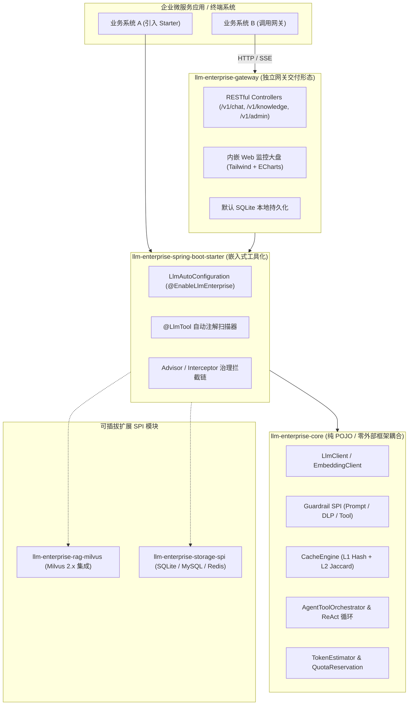
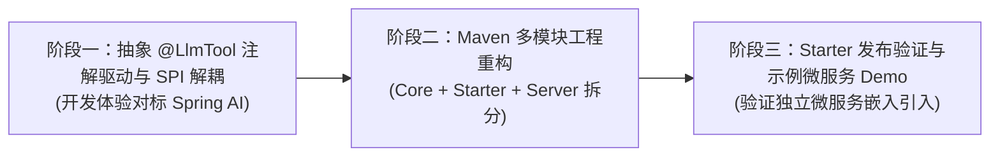

# LLM-Enterprise-Hub 工具化、自主迁移与 Spring AI 式架构演进规划

> **For agentic workers:** REQUIRED SUB-SKILL: Use `superpowers:subagent-driven-development` to implement this plan task-by-task. Steps use checkbox (`- [ ]`) syntax for tracking.

**Goal:** 评估并落地 LLM-Enterprise-Hub 的**工具化（Toolization / SDK 化）**、**模块化解耦（多 Maven Module）**与**类 Spring AI 编程范式扩展**，使其既能作为**独立高性能 API 网关**运行，又能作为 **`llm-enterprise-spring-boot-starter` 嵌入任何企业微服务**，并支持自定义持久化、分布式缓存及 `@LlmTool` 注解驱动。

**Architecture & Core Findings:**
1. **现状评估（可迁移性极高）**：
   - 当前项目已具备清晰的六大能力维度，且核心接口已高度抽象（`LlmClient`, `EmbeddingClient`, `VectorStore`, `DlpRuleProvider`, `PromptRuleProvider`, `ToolHandler`）。依赖非常克制（仅 Spring Boot、SQLite、JTokkit、Jackson），没有繁重不可控的第三方黑盒，**具备极佳的工具化与移植基因**。
2. **对标 Spring AI 的优势与差异化定位**：
   - **Spring AI 的强项**：统一模型抽象（`ChatModel`）、向量抽象（`VectorStore`）、`@Tool` 注解扫描与函数反射注册。
   - **当前 Hub 针对企业级场景的超越之处**：Spring AI **完全缺乏多租户治理**（无平滑令牌桶、无 BPE 额度两阶段预扣与结算）、**缺乏全链路双向动态安全护栏**（无 DLP 正则动态脱敏、无提示词注入过滤、无工具越权物理隔离）、**缺乏带状态机的云边主备熔断**、**缺乏 Agent 长任务 Checkpoint 事务持久化与断点续跑**、**缺乏开箱即用的实时监控 Web 大盘**。
   - **定位**：打造 **"Spring AI for Enterprise (企业级增强版 AI 工具套件与网关)"**。
3. **工具化演进形态（双模运行）**：
   - **形态 1：SDK / Starter 模式 (`llm-enterprise-spring-boot-starter`)**：任何外部业务系统 `pom.xml` 引入一个依赖，在业务代码中直接注入 `LlmClient`、`AgentToolOrchestrator` 或标注 `@LlmTool` 即可使用企业治理与安全能力；
   - **形态 2：独立集中网关模式 (`llm-enterprise-gateway-server`)**：开箱即用的独立 Docker 容器或 Jar，对外暴露统一 OpenAI 兼容标准接口、知识库接口与管理控制面。



---

## User Review Required

> [!IMPORTANT]
> **多模块拆分方案的向后兼容策略**：
> 采用 **"单工程渐进式多模块拆分 (Maven Multi-Module)"**：
> 1. `llm-enterprise-hub` 根工程改造为聚合父 POM (`<packaging>pom</packaging>`)；
> 2. 原业务逻辑平滑拆分为：
>    - `llm-enterprise-core`（核心领域接口与算法，0 Web 依赖）；
>    - `llm-enterprise-spring-boot-starter`（Spring 自动装配、属性绑定、注解扫描工具）；
>    - `llm-enterprise-gateway-server`（包含 Web 控制器、SQLite 持久化与前端看板的可执行 Jar）；
> 3. 已有的 114 个单元测试和集成测试无损迁移并保证 100% 通过。

---

## 核心设计与定制开发拓展点 (Customization SPI)

为达成类似于 Spring AI 的高度定制化与工具化能力，重点打造四大扩展机制：

### 1. `@LlmTool` 注解驱动的自动化函数调用 (Like Spring AI `@Tool`)
外部业务系统只需在任意 Spring Bean 的普通方法上添加注解，即可自动识别参数 Schema 并注册到工具库：
```java
@Component
public class OrderService {

    @LlmTool(name = "query_order_status", description = "根据订单编号查询订单履约状态")
    public String getOrderStatus(@LlmToolParam(name = "order_id", description = "订单号") String orderId) {
        return "订单 " + orderId + " 已发货，物流单号 SF10086";
    }
}
```
**实现机制**：由 `LlmToolBeanPostProcessor` 在 Spring 启动时自动扫描所有带有 `@LlmTool` 的 Bean 方法，基于反射生成标准 JSON Schema 的 `ToolDefinition` 并自动注册到 `ToolRegistry`。

### 2. 存储与状态机 SPI 解耦 (`StorageProvider`)
- 当前租户表与 Agent 任务表绑定 SQLite；
- 工具化后抽象 `TenantStorageProvider` 与 `AgentTaskStorageProvider` 接口：
  - 默认提供 `SqliteStorageProvider`（开发与单机使用）；
  - 预留拓展 `JpaStorageProvider`（MySQL / PostgreSQL）与 `RedisStorageProvider`（多实例分布式集群）。

### 3. 多租户配额与限流 SPI (`RateLimitProvider` & `QuotaProvider`)
- 单机模式：现有内存级平滑令牌桶 `TenantRateLimiter`；
- 集群模式：支持企业通过配置无缝切换为 Redis Lua 脚本分布式限流与分布式配额原子预扣。

### 4. 向量存储可插拔 SPI (`VectorStore`)
- 现有 `MilvusVectorStore`（直连 Milvus 2.x RESTful + 内存余弦降级）；
- 企业可自由实现 `VectorStore` 接入 PGvector, Chroma, Qdrant 或 Elasticsearch。

---

## 模块化拆分实施计划 (Multi-Module Decomposition)

### Module 1: `llm-enterprise-core`
**定位**：纯 Java 领域模型与核心算法，极度轻量，无任何 Spring Web 或数据库强制依赖。
- **包含组件**：
  - `model/*`：OpenAI 协议模型（Request, Response, Chunk, Usage, ChatMessage）
  - `client/*`：`LlmClient` 接口与 `OpenAiCompatibleLlmClient`（基于标准 `java.net.http.HttpClient`）
  - `token/*`：`TokenEstimator`（JTokkit BPE 分词）
  - `cache/*`：`CacheEngine`（L1 Hash + L2 相似度）
  - `guard/*`：`PromptGuardrailService`, `OutputGuardrailService`, `ToolActionGatekeeper`, 规则接口
  - `router/*`：`FailoverRoutingService`（状态机熔断与重试）
  - `agent/*`：`AgentToolOrchestrator`, `ToolRegistry`, `ToolHandler`
  - `rag/*`：`TextChunker`, `EmbeddingClient`, `VectorStore`, `PromptAugmentor`

### Module 2: `llm-enterprise-spring-boot-starter`
**定位**：Spring Boot 开发者体验与自动配置中枢，引入即可享受自动装配。
- **包含组件**：
  - `LlmAutoConfiguration`：条件化自动装配所有的 Client、Router、Cache、Guardrail
  - `@EnableLlmEnterprise`：注解开关
  - `@LlmTool` 与 `@LlmToolParam`：工具注解与自动扫描器 `LlmToolBeanPostProcessor`
  - `properties/*`：`LlmProperties`, `SecurityProperties`, `CacheProperties`, `RagProperties`
  - 拦截器与切面治理（Advisor 模式）

### Module 3: `llm-enterprise-gateway-server`
**定位**：开箱即用的独立网关可执行服务。
- **包含组件**：
  - 依赖 `llm-enterprise-spring-boot-starter`
  - `controller/ChatCompletionController`（OpenAI 兼容接口）
  - `rag/KnowledgeBaseController`（知识库管理接口）
  - `admin/AdminController` 与 `agent/task/AgentTaskController`
  - SQLite Repository 与数据库初始化脚本
  - 内嵌 Web 监控大盘前端页面 (`static/index.html`)

---

## 阶段规划与交付步骤



### 阶段一：@LlmTool 注解驱动与组件 SPI 抽象
1. 创建 `@LlmTool` 与 `@LlmToolParam` 注解；
2. 实现 `LlmToolBeanPostProcessor`，自动将任意 Spring Bean 方法反射识别为 OpenAI 规范的 Function Tool，并注册到 `ToolRegistry`；
3. 为 `TenantService` 与 `AgentTaskManager` 抽取标准 Storage SPI 接口；
4. 编写 `@LlmTool` 自动化单元与集成测试。

### 阶段二：Maven 多模块工程拆分
1. 建立根 POM，创建 `llm-enterprise-core`、`llm-enterprise-spring-boot-starter`、`llm-enterprise-gateway-server` 三个子模块；
2. 迁移源码与测试用例，明确模块间依赖传递；
3. 执行全量 `./mvnw clean verify`，确保 114+ 测试用例全部平移并通过。

### 阶段三：示例 Demo 与嵌入式微服务验证
1. 在 `samples/` 下建立一个标准的业务微服务 Demo：
   - 依赖 `llm-enterprise-spring-boot-starter`；
   - 标注 `@LlmTool` 自定义本地业务逻辑；
   - 验证直接注入 `LlmClient` 与 `AgentToolOrchestrator` 的使用体验；
2. 更新文档与 Starter 使用说明指南。

---

## 验证计划 (Verification Plan)

### 自动化测试
1. **注解扫描单测**：
   `./mvnw test -Dtest=LlmToolAnnotationScanTest`（验证 `@LlmTool` 能否正确解析出参数 schema 并执行方法）
2. **多模块全量回归验证**：
   `./mvnw clean verify`
   预期输出：所有模块均输出 `BUILD SUCCESS`，114+ 测试用例 100% 通过。
3. **Starter 依赖隔离性验证**：
   在 `llm-enterprise-core` 模块中执行依赖树检查 `mvn dependency:tree`，确保没有任何 Web 相关 jar 包引入，保证纯粹性。

### 人工验证
1. 检查 Spring Boot 启动日志，确认带有 `@LlmTool` 的自定义 Bean 能够在应用启动时被自动识别并注册到模型工具池；
2. 验证外部独立应用引入 Starter 后，通过简单的 `application.yml` 配置即可激活企业级治理与模型能力。
