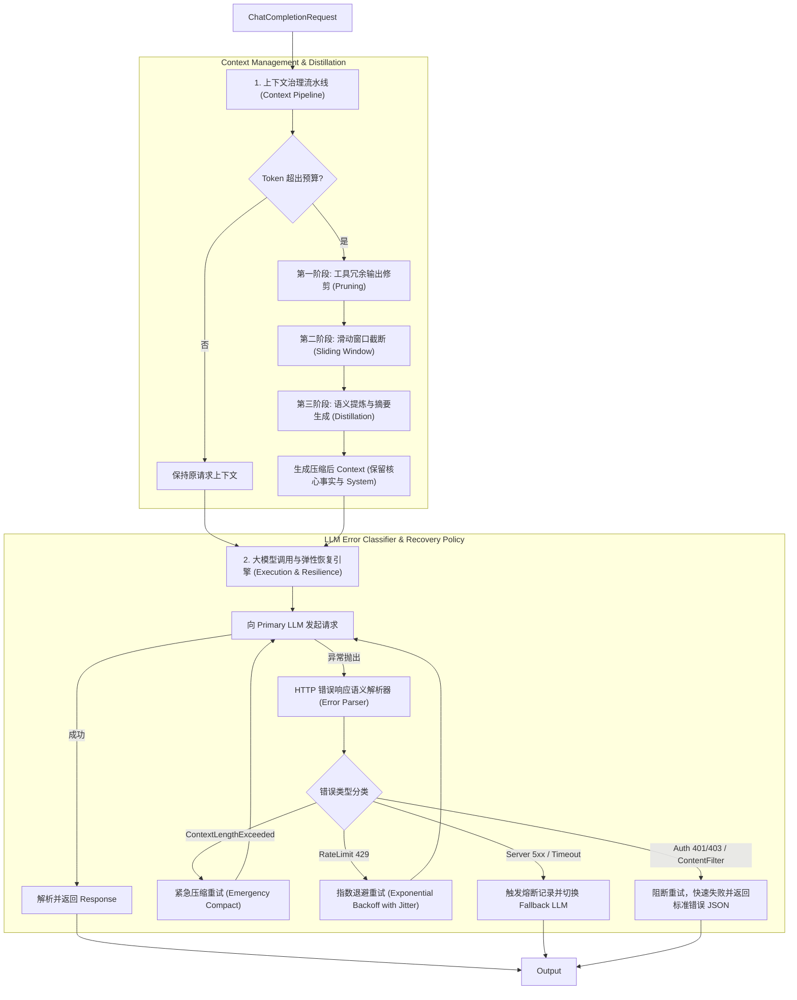
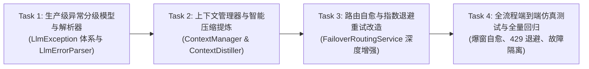

# 大厂生产级上下文工程（压缩/提炼）与大模型异常恢复治理方案

> **For agentic workers:** REQUIRED SUB-SKILL: Use `superpowers:subagent-driven-development` to implement this plan task-by-task. Steps use checkbox (`- [ ]`) syntax for tracking.

**Goal:** 补齐 `llm-enterprise-core` 在企业级严苛生产环境下缺失的**长上下文管理、窗口滑动、工具结果修剪与语义提炼压缩（Context Distillation）**，并构建**大厂标准的异常分类分级体系（Retryable/Fatal）、上游错误语义解析、上下文溢出自动压缩自愈与指数退避故障恢复机制**。

---

## 现状诊断与大厂生产标准差距

通过深入剖析现有代码库与一线大厂（OpenAI / Anthropic / Azure / DSH 等）生产网关对比，发现两大核心短板：

| 维度 | 当前项目现状 | 大厂生产级要求 (Target) |
| :--- | :--- | :--- |
| **上下文管理 (Context Management)** | 仅有无限制向 `messages` 追加逻辑（在 Agent 循环中累加历史）；无上下文窗口大小感知，历史越长 Token 消耗呈二次方爆炸，极易突破模型硬性上限（如 4k/8k/32k）。 | **分级上下文预算分配与压缩引擎**：<br>1. **Token 预算分配器**（System / Recency User / History Budget）；<br>2. **长历史滑动窗口**（保留 System 首因效应 + 最近 K 轮）；<br>3. **工具输出修剪器 (Tool Output Pruner)**（对陈旧的冗余大 JSON 结果进行摘要替换）；<br>4. **语义提炼压缩器 (Context Distillation)**（将旧轮次摘要为结构化会话备忘，节省 70%+ Token）。 |
| **异常分类体系 (Exception Hierarchy)** | 仅在 `OpenAiCompatibleLlmClient` 粗暴抛出 `RuntimeException("Upstream LLM error: HTTP " + status)`；调用方无法识别错误类型，只能盲目判定熔断。 | **全分级结构化异常类图**：<br>细分为 **可重试错误 (Retryable)**（429 限流退避、500/502/503/504 抖动、超时）与 **非重试错误 (Fatal)**（401/403 凭据失效、400 参数格式错误、400 内容安全拦截、400 上下文超限）。 |
| **错误恢复与自愈 (Self-Healing Recovery)** | 主备切换仅基于简单计数，当发生 `context_length_exceeded` 时，降级到同等窗口模型仍然必死，且无法动态修复。 | **自愈重试与协同降级**：<br>1. 命中 429 自动解析 `Retry-After` Header，执行带抖动的指数退避（Jittered Backoff）；<br>2. 命中 `context_length_exceeded` 自动触发**现场紧急压缩 (Emergency Compaction)** 并就地原位重试，彻底解决长会话爆窗宕机；<br>3. 标准化 OpenAI 错误响应输出，杜绝向客户端泄露 Java 堆栈。 |

---

## 整体架构设计全景



---

## User Review Required

> [!IMPORTANT]
> **大厂生产实践核心参数决策**：
> 1. **上下文压缩触发水位线 (High-Water Mark)**：默认建议设为模型最大窗口的 **75%**。达到此阈值时无感启动增量压缩，防止突发大 Prompt 造成即时溢出；
> 2. **System Prompt 与最新轮次不可压缩守则**：System 提示词定义了系统人设与基础规则，最新的一轮 User-Assistant 对话属于当前执行语义，**这两部分受到绝对保护，禁止被滑动窗口抛弃**；
> 3. **工具返回裁剪策略**：超过两轮以上的历史 `role: tool` 消息，若字符长度超过 500 字符，自动折叠为 `{"status": "success", "summary": "[Earlier tool output pruned for context efficiency]"}`。

---

## Proposed Changes

### Component 1: 上下文管理、滑动窗口与语义提炼 (`com.enterprise.llm.context`)

#### [NEW] `com.enterprise.llm.context.ContextBudgetProperties`
- 映射 `llm.context.*` 配置：
  - `int maxContextTokens`: 默认窗口预算（如 8192 或 32768）；
  - `double compressionTriggerRatio`: 压缩触发比例（默认 0.75）；
  - `int reservedResponseTokens`: 为大模型输出预留的 Token 数（默认 1024）；
  - `int keepLastMessages`: 滑动窗口最少保留的最近消息条数（默认 4 条）；
  - `boolean toolPruningEnabled`: 是否启用陈旧工具结果剪裁（默认 true）。

#### [NEW] `com.enterprise.llm.context.ContextManager` (核心服务)
- `ChatCompletionRequest manageContext(ChatCompletionRequest request, int modelTokenLimit)`：
  1. 调用 `TokenEstimator` 计算请求总 Token；
  2. 若 `totalTokens + reservedTokens > maxContextTokens`，按阶段执行治理：
     - **Phase 1: 工具消息修剪 (`pruneOldToolMessages`)**：对非最新轮次的冗长 Tool 结果实施裁剪折叠；
     - **Phase 2: 滑动窗口保活 (`applySlidingWindow`)**：保留 System 消息和尾部 `keepLastMessages` 条对话；
     - **Phase 3: 语义提炼 (`distillAndSummarize`)**：将已被丢弃的历史消息提炼为一条结构化上下文系统消息：`ChatMessage.system("【历史对话摘要与上下文背景】: ...")`。

#### [NEW] `com.enterprise.llm.context.ContextDistiller` (摘要压缩接口与启发式实现)
- 接口 `ContextDistiller`: `String distill(List<ChatMessage> expiredMessages)`；
- 默认提供高性能纯本地轻量提炼实现 `HeuristicContextDistiller`（快速提取意图、核心事实与实体，无需额外发请求）；并支持插拔基于大模型异步总结的 `LlmModelContextDistiller`。

---

### Component 2: 大厂生产级大模型异常分级体系 (`com.enterprise.llm.exception`)

#### [NEW] `com.enterprise.llm.exception.LlmException` (基类)
```java
public abstract class LlmException extends RuntimeException {
    private final int statusCode;
    private final String errorCode;
    private final String errorType;
    private final boolean retryable;
    // ...
}
```

#### [NEW] 具体异常派生分级类：
1. **`LlmRateLimitException`**（HTTP 429，`retryable = true`）：
   - 支持从响应头解析 `retry-after-ms`。
2. **`LlmServerException`**（HTTP 500, 502, 503, 504，超时，`retryable = true`）：
   - 标注上游服务器宕机或网关抖动。
3. **`LlmContextLengthExceededException`**（HTTP 400 且错误码为 context_length_exceeded，`retryable = false`，但具有**自愈自恢复特性**）。
4. **`LlmAuthenticationException`**（HTTP 401/403，`retryable = false`）：
   - 上游 API Key 无效或欠费封禁，禁止无意义重试。
5. **`LlmContentFilterException`**（HTTP 400 内容审查触发，`retryable = false`）。
6. **`LlmInvalidRequestException`**（HTTP 400 参数格式错误，`retryable = false`）。

#### [NEW] `com.enterprise.llm.client.LlmErrorParser`
- 负责拦截上游 4xx/5xx 的 JSON 响应，解析上游 OpenAI / Ollama / 云端模型标准的 `error` 结构体：
  `{ "error": { "message": "...", "type": "...", "code": "..." } }`
- 精确映射生成对应的强类型 `LlmException`。

---

### Component 3: 弹性容错与故障自愈执行器 (`com.enterprise.llm.router`)

#### [MODIFY] `com.enterprise.llm.client.OpenAiCompatibleLlmClient`
- 替换现有的无类型 `RuntimeException` 抛出，集成 `LlmErrorParser`，精准抛出 `LlmRateLimitException`、`LlmContextLengthExceededException` 等强类型异常。

#### [MODIFY] `com.enterprise.llm.router.FailoverRoutingService`
- 升级故障转移逻辑，实现大厂级自愈重试：
  1. **指数退避重试 (Exponential Backoff with Jitter)**：
     - 当捕获到 `LlmRateLimitException` 或短暂 `LlmServerException` 时，根据退避算法（如 200ms -> 400ms -> 800ms + 随机抖动）在虚拟线程内重试（最多 3 次）；
  2. **上下文爆窗自愈 (Auto-Recovery on ContextLengthExceeded)**：
     - 当捕获到 `LlmContextLengthExceededException` 时，**不直接报错**，而是立即调用 `ContextManager.forceEmergencyCompaction(request)` 将上下文大幅砍半，并在原位发起重试！
  3. **非重试致命错误快速短路**：
     - 若遭遇 `LlmAuthenticationException` 或 `LlmContentFilterException`，直接向上抛出，绝不进行盲目重试污染主备链路。

#### [MODIFY] `com.enterprise.llm.controller.ChatCompletionController`
- 集成全局异常统一映射：当任何未处理的 `LlmException` 到达 Controller 时，转换为标准的 OpenAI 错误格式 JSON 并输出正确的 HTTP 状态码。

---

## 阶段规划与执行步骤



### Task 1: 生产级异常分级体系构建
- 实现 `LlmException` 及 6 大派生异常类；
- 实现 `LlmErrorParser`，支持标准 OpenAI 及各类主流厂商错误体解析；
- 改造 `OpenAiCompatibleLlmClient` 同步与流式通道；
- 编写异常分类与解析器单元测试。

### Task 2: 上下文管理、窗口修剪与语义提炼引擎
- 实现 `ContextBudgetProperties` 与 `ContextManager`；
- 实现工具历史裁剪算法与自然断句滑动窗口；
- 实现 `HeuristicContextDistiller` 对被淘汰历史的信息提炼；
- 编写上下文预算计算、剪裁、摘要生成单元测试。

### Task 3: 路由层自愈重试与网关错误标准化
- 在 `FailoverRoutingService` 中编排重试退避策略与自愈恢复；
- 改造 `ChatCompletionController` 的全局异常兜底与 OpenAI 标准 JSON 返回；
- 编写 429 退避重试、爆窗压缩自愈与 401 立即短路单元测试。

### Task 4: 端到端生产仿真集成测试与验证
- 编写 `ContextCompactionAndResilienceE2ETest`：
  - 场景 1：模拟极端长文本请求导致 400 Context Exceeded，验证网关自动裁剪压缩后原位重试成功；
  - 场景 2：模拟 Primary 上游 429 Too Many Requests，验证指数退避重试并成功恢复；
  - 场景 3：模拟 Primary 持续 500 宕机，验证熔断并切换 Fallback 边端模型；
- 执行全工程 `./mvnw clean verify`，确保所有现有 114+ 测试及新增测试 100% 绿色通过。

---

## 验证计划 (Verification Plan)

### Automated Tests
1. **异常解析单测**：
   `./mvnw test -Dtest=LlmErrorParserTest`（验证各种 HTTP 状态码及错误 JSON 字段精确映射）
2. **上下文压缩提炼单测**：
   `./mvnw test -Dtest=ContextManagerTest`（验证超限自动修剪工具消息、保留 System、提炼摘要）
3. **大模型弹性恢复集成测试**：
   `./mvnw test -Dtest=FailoverRoutingResilienceTest`（验证 429 退避、爆窗重试自愈）
4. **全工程回归套件**：
   `./mvnw clean verify`
   预期：`BUILD SUCCESS`，120+ 测试用例 100% 通过。

### Manual Verification
1. 观察 MockWebServer 上游接收到的自愈请求：验证发生 Context 超限后，第二次重试的请求体明显变小且携带了 `【历史对话摘要与上下文背景】`；
2. 验证出现 401 凭证错误时，网关立即以标准化 OpenAI JSON 报错，避免不必要的网络空转重试。
