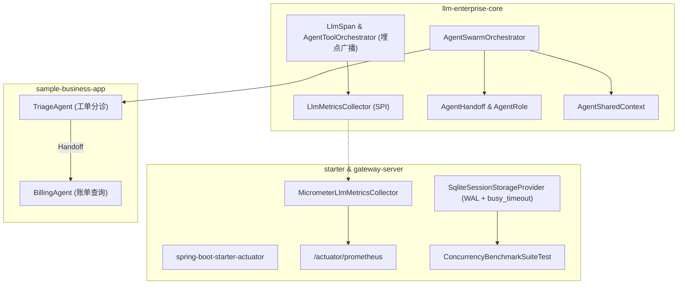

# Metrics, Benchmark Suite, and Multi-Agent Workflow Implementation Plan

> **For agentic workers:** REQUIRED SUB-SKILL: Use superpowers:subagent-driven-development to implement this plan task-by-task. Steps use checkbox (`- [ ]`) syntax for tracking.

**Goal:** 构建企业级可观测度量体系 (Prometheus/Micrometer)、高并发压测基准套件 (SQLite WAL 并发与虚拟线程 Tool 加速比) 以及多 Agent 协同工作流引擎 (Swarm / Handoff / 共享黑板)。

**Architecture:** 
1. **Core 指标 SPI 与 Gateway Actuator 闭环**：Core 层定义零依赖 `LlmMetricsCollector` SPI，Starter 自动绑定 `MeterRegistry`，Gateway 暴露 `/actuator/prometheus`。
2. **SQLite WAL 并发调优与压测基准**：配置 SQLite WAL 与 5000ms busy_timeout，编写多线程与虚拟线程性能基准套件输出 TPS、P99 与并发加速比。
3. **多 Agent 协同工作流引擎**：实现 `AgentRole`、`AgentHandoff`、`AgentSharedContext` 与 `AgentSwarmOrchestrator`，并在 `sample-business-app` 落地智能客服分诊实战。

**Architecture Diagram:**



**Tech Stack:** Java 21, Spring Boot 3.3.4, Spring Boot Actuator, Micrometer Prometheus, SQLite JDBC (WAL mode), Virtual Threads (`Executors.newVirtualThreadPerTaskExecutor()`), JUnit 5, AssertJ.

---

### Task 1: Core 层指标度量 SPI 接口与默认收集器

**Files:**
- Create: `llm-enterprise-core/src/main/java/com/enterprise/llm/metrics/LlmMetricsCollector.java`
- Create: `llm-enterprise-core/src/main/java/com/enterprise/llm/metrics/NoOpMetricsCollector.java`
- Create: `llm-enterprise-core/src/main/java/com/enterprise/llm/metrics/CompositeMetricsCollector.java`
- Test: `llm-enterprise-core/src/test/java/com/enterprise/llm/metrics/LlmMetricsCollectorTest.java`

- [ ] **Step 1: 编写失败测试 `LlmMetricsCollectorTest.java`**

```java
package com.enterprise.llm.metrics;

import org.junit.jupiter.api.Test;
import java.util.concurrent.atomic.AtomicInteger;
import static org.assertj.core.api.Assertions.assertThat;

class LlmMetricsCollectorTest {

    @Test
    void testNoOpMetricsCollectorDoesNotThrow() {
        LlmMetricsCollector noop = NoOpMetricsCollector.INSTANCE;
        noop.recordRequest("gpt-4o", "tenant-1", "success", 120, 50L, 25.5, 100, 200);
        noop.recordToolExecution("calc", "tenant-1", "success", 15);
        noop.recordActiveRequest("gpt-4o", 1);
        noop.recordActiveRequest("gpt-4o", -1);
    }

    @Test
    void testCompositeMetricsCollectorBroadcasts() {
        AtomicInteger reqCount = new AtomicInteger(0);
        AtomicInteger toolCount = new AtomicInteger(0);
        AtomicInteger activeDelta = new AtomicInteger(0);

        LlmMetricsCollector custom = new LlmMetricsCollector() {
            @Override
            public void recordRequest(String model, String tenantId, String status, long durationMs, Long ttftMs, Double tps, int promptTokens, int completionTokens) {
                reqCount.incrementAndGet();
            }
            @Override
            public void recordToolExecution(String toolName, String tenantId, String status, long durationMs) {
                toolCount.incrementAndGet();
            }
            @Override
            public void recordActiveRequest(String model, int delta) {
                activeDelta.addAndGet(delta);
            }
        };

        CompositeMetricsCollector composite = new CompositeMetricsCollector();
        composite.addCollector(custom);

        composite.recordRequest("gpt-4o", "tenant-1", "success", 100, 40L, 30.0, 50, 100);
        composite.recordToolExecution("weather", "tenant-1", "success", 10);
        composite.recordActiveRequest("gpt-4o", 2);

        assertThat(reqCount.get()).isEqualTo(1);
        assertThat(toolCount.get()).isEqualTo(1);
        assertThat(activeDelta.get()).isEqualTo(2);
    }
}
```

- [ ] **Step 2: 运行测试验证失败**
Run: `./mvnw test -pl llm-enterprise-core -Dtest=LlmMetricsCollectorTest`
Expected: FAIL (Compilation error: cannot find symbol `LlmMetricsCollector`)

- [ ] **Step 3: 编写 Core 层 SPI 接口与实现**
编写 `LlmMetricsCollector.java`, `NoOpMetricsCollector.java`, `CompositeMetricsCollector.java`。

- [ ] **Step 4: 运行测试验证通过**
Run: `./mvnw test -pl llm-enterprise-core -Dtest=LlmMetricsCollectorTest`
Expected: BUILD SUCCESS (2 tests passed)

- [ ] **Step 5: 提交代码**
```bash
git add llm-enterprise-core/src/main/java/com/enterprise/llm/metrics/ llm-enterprise-core/src/test/java/com/enterprise/llm/metrics/
git commit -m "feat(core): introduce LlmMetricsCollector SPI and composite collector"
```

---

### Task 2: Core 层 LlmSpan 与 AgentToolOrchestrator 埋点上报

**Files:**
- Modify: `llm-enterprise-core/src/main/java/com/enterprise/llm/trace/LlmSpan.java`
- Modify: `llm-enterprise-core/src/main/java/com/enterprise/llm/agent/AgentToolOrchestrator.java`
- Test: `llm-enterprise-core/src/test/java/com/enterprise/llm/trace/LlmSpanTest.java`
- Test: `llm-enterprise-core/src/test/java/com/enterprise/llm/agent/AgentToolOrchestratorTest.java`

- [ ] **Step 1: 在 `LlmSpanTest` 中增加完成时度量触发测试**
- [ ] **Step 2: 运行测试验证失败**
- [ ] **Step 3: 修改 `LlmSpan` 与 `AgentToolOrchestrator` 支持注入/挂载 `LlmMetricsCollector` 并在生命周期事件中触发上报**
- [ ] **Step 4: 运行全部 Core 模块测试确保兼容性**
Run: `./mvnw test -pl llm-enterprise-core`
Expected: BUILD SUCCESS (All tests pass)
- [ ] **Step 5: 提交代码**
```bash
git commit -am "feat(core): trigger metrics collector in LlmSpan and AgentToolOrchestrator"
```

---

### Task 3: Starter 层基于 Micrometer 的 Prometheus 指标适配器与自动装配

**Files:**
- Modify: `llm-enterprise-spring-boot-starter/pom.xml` (引入 `micrometer-core` optional 依赖)
- Create: `llm-enterprise-spring-boot-starter/src/main/java/com/enterprise/llm/starter/metrics/MicrometerLlmMetricsCollector.java`
- Modify: `llm-enterprise-spring-boot-starter/src/main/java/com/enterprise/llm/starter/config/LlmEnterpriseAutoConfiguration.java`
- Test: `llm-enterprise-spring-boot-starter/src/test/java/com/enterprise/llm/starter/metrics/MicrometerLlmMetricsCollectorTest.java`

- [ ] **Step 1: 编写 `MicrometerLlmMetricsCollectorTest.java`**
使用 `SimpleMeterRegistry` 验证 `llm.requests.total`, `llm.request.duration`, `llm.time.to.first.token`, `llm.tokens.total`, `llm.tool.duration`, `llm.active.requests` 正常注册并被度量。
- [ ] **Step 2: 运行测试验证失败**
- [ ] **Step 3: 实现 `MicrometerLlmMetricsCollector` 并在自动配置中当容器存在 `MeterRegistry` 时自动注入为 Bean**
- [ ] **Step 4: 运行 Starter 测试验证通过**
Run: `./mvnw test -pl llm-enterprise-spring-boot-starter`
Expected: BUILD SUCCESS
- [ ] **Step 5: 提交代码**
```bash
git commit -am "feat(starter): implement MicrometerLlmMetricsCollector and auto-configuration"
```

---

### Task 4: Gateway Server 接入 Actuator Prometheus 端点与全链路测试

**Files:**
- Modify: `llm-enterprise-gateway-server/pom.xml` (引入 `spring-boot-starter-actuator` 与 `micrometer-registry-prometheus`)
- Modify: `llm-enterprise-gateway-server/src/main/resources/application.yml` (配置 `management.endpoints.web.exposure.include: health,info,prometheus`)
- Test: `llm-enterprise-gateway-server/src/test/java/com/enterprise/llm/controller/PrometheusActuatorEndpointTest.java`

- [ ] **Step 1: 编写端到端端点验证测试 `PrometheusActuatorEndpointTest.java`**
发送推理请求后调用 `/actuator/prometheus`，断言返回 200 且响应体中包含 `llm_requests_total` 与 `llm_tokens_total`。
- [ ] **Step 2: 运行测试验证失败**
- [ ] **Step 3: 更新 pom.xml 和 application.yml 暴露 Prometheus 端点**
- [ ] **Step 4: 运行测试验证通过**
Run: `./mvnw test -pl llm-enterprise-gateway-server -Dtest=PrometheusActuatorEndpointTest`
Expected: BUILD SUCCESS
- [ ] **Step 5: 提交代码**
```bash
git commit -am "feat(gateway): expose /actuator/prometheus endpoint and verify LLM metrics"
```

---

### Task 5: SQLite WAL 模式并发调优与高并发基准测试套件

**Files:**
- Modify: `llm-enterprise-gateway-server/src/main/java/com/enterprise/llm/session/SqliteSessionStorageProvider.java`
- Create: `llm-enterprise-gateway-server/src/test/java/com/enterprise/llm/benchmark/ConcurrencyBenchmarkSuiteTest.java`

- [ ] **Step 1: 优化 SQLite 连接与初始化参数**
在表初始化时执行 `PRAGMA journal_mode=WAL;` 以及设置 `PRAGMA busy_timeout=5000;` 和 `PRAGMA synchronous=NORMAL;`。
- [ ] **Step 2: 编写并发基准测试套件 `ConcurrencyBenchmarkSuiteTest.java`**
1. `benchmarkSqliteConcurrentWrites()`: 50 并发虚拟线程并发写入 500 个不同会话和消息，断言 100% 成功且吞吐量 > 200 ops/s；
2. `benchmarkVirtualThreadToolParallelism()`: 模拟单轮 10 个 50ms Tool 调用，断言总耗时 < 150ms（串行需要 500ms，加速比 > 3x）；
3. 打印详细的并发基准测试指标报告（TPS、P50、P99、耗时对比）。
- [ ] **Step 3: 运行并发压测套件验证通过**
Run: `./mvnw test -pl llm-enterprise-gateway-server -Dtest=ConcurrencyBenchmarkSuiteTest`
Expected: BUILD SUCCESS (All benchmarks pass with detailed report)
- [ ] **Step 4: 提交代码**
```bash
git commit -am "feat(gateway): tune SQLite WAL mode and add ConcurrencyBenchmarkSuiteTest"
```

---

### Task 6: Core 层多 Agent 协同工作流引擎 (Swarm / Handoff / Context)

**Files:**
- Create: `llm-enterprise-core/src/main/java/com/enterprise/llm/agent/swarm/AgentRole.java`
- Create: `llm-enterprise-core/src/main/java/com/enterprise/llm/agent/swarm/AgentHandoff.java`
- Create: `llm-enterprise-core/src/main/java/com/enterprise/llm/agent/swarm/AgentSharedContext.java`
- Create: `llm-enterprise-core/src/main/java/com/enterprise/llm/agent/swarm/AgentSwarmOrchestrator.java`
- Test: `llm-enterprise-core/src/test/java/com/enterprise/llm/agent/swarm/AgentSwarmOrchestratorTest.java`

- [ ] **Step 1: 编写失败测试 `AgentSwarmOrchestratorTest.java`**
测试多角色 Agent：TriageAgent 根据输入自动委托给 BillingAgent 或 TechAgent，验证共享上下文传递、防循环 Handoff 熔断与最终响应返回。
- [ ] **Step 2: 运行测试验证失败**
Run: `./mvnw test -pl llm-enterprise-core -Dtest=AgentSwarmOrchestratorTest`
Expected: FAIL
- [ ] **Step 3: 编写核心实现**
实现 `AgentRole`, `AgentHandoff`, `AgentSharedContext`, `AgentSwarmOrchestrator`。
- [ ] **Step 4: 运行测试验证通过**
Run: `./mvnw test -pl llm-enterprise-core -Dtest=AgentSwarmOrchestratorTest`
Expected: BUILD SUCCESS
- [ ] **Step 5: 提交代码**
```bash
git commit -am "feat(core): implement Multi-Agent Swarm orchestrator, handoff and shared context"
```

---

### Task 7: 业务示例应用接入智能客服多 Agent 工作流实战

**Files:**
- Create: `samples/sample-business-app/src/main/java/com/sample/business/swarm/CustomerSupportSwarmService.java`
- Create: `samples/sample-business-app/src/main/java/com/sample/business/swarm/TriageTools.java`
- Test: `samples/sample-business-app/src/test/java/com/sample/business/swarm/CustomerSupportSwarmTest.java`

- [ ] **Step 1: 编写实战测试 `CustomerSupportSwarmTest.java`**
模拟真实业务场景：工单分诊 -> 订单财务处理 -> 给出业务答案。
- [ ] **Step 2: 运行测试验证失败**
- [ ] **Step 3: 编写 `CustomerSupportSwarmService` 与业务转交工具**
- [ ] **Step 4: 运行测试验证通过**
Run: `./mvnw test -pl samples/sample-business-app -Dtest=CustomerSupportSwarmTest`
Expected: BUILD SUCCESS
- [ ] **Step 5: 提交代码**
```bash
git commit -am "feat(samples): implement multi-agent customer support swarm in sample-business-app"
```

---

### Task 8: 全工程回归验证、指标导出压测复核与文档更新

**Files:**
- Modify: `README.md`
- Test: 全量 `./mvnw clean verify`

- [ ] **Step 1: 执行全工程回归构建与验证**
Run: `./mvnw clean verify`
Expected: BUILD SUCCESS (所有模块全部绿色通过，用例数 > 155)
- [ ] **Step 2: 更新 `README.md` 章节**
补充 Prometheus 指标字典、压测基准数据与多 Agent 工作流开发指南。
- [ ] **Step 3: 最终 Git 提交**
```bash
git commit -am "docs: update README with metrics dictionary, benchmark results, and swarm guide"
```
