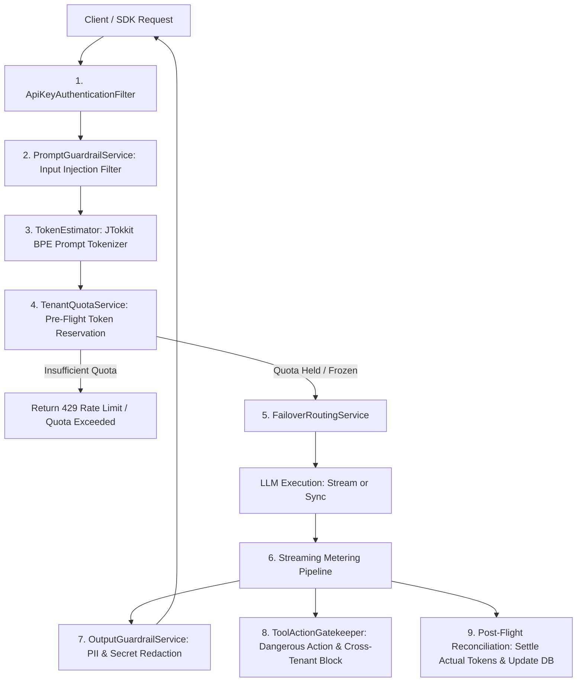

# Phase 3 Design Specification: Token Prediction, Streaming Metering & Post-Execution Action Guardrails

## 1. Goal
Implement enterprise-grade token estimation, pre-reservation, streaming metering and quota reconciliation (`TokenMeteringService`), paired with post-execution safety filters: output sensitive data redaction (`OutputGuardrailService`) and tool execution boundary/risk verification (`ToolActionGatekeeper`).

---

## 2. Architecture & Data Flow

---

## 3. Core Components

### 3.1 Token Prediction & Estimation (`TokenEstimator`)
- **Technology**: `com.knuddels:jtokkit:1.1.0` (BPE tokenizer for cl100k_base).
- **Prompt Calculation**: Fast token counting for single messages or full chat conversation arrays.
- **Completion Estimation**:
  $$\text{Estimated Total} = \text{Prompt Tokens} + \max(\text{request.max\_tokens}, \text{DEFAULT\_COMPLETION\_ESTIMATE})$$
  Default completion estimate = 512 tokens when `max_tokens` is omitted.

### 3.2 Tenant Quota & Metering Service (`TenantQuotaService`)
- **Reservation Phase (`tryReserve`)**:
  - Atomically checks if `tenant.used_tokens + tenant.frozen_tokens + estimated <= daily_token_quota`.
  - Increments in-memory `frozen_tokens` counter per tenant.
  - Rejects with `429 Too Many Requests` if quota is insufficient.
- **Settlement Phase (`settle`)**:
  - Deducts `frozen_tokens`.
  - Adds `actual_tokens` to in-memory `used_tokens` and persists to SQLite asynchronously.

### 3.3 Output Safety & DLP Guardrail (`OutputGuardrailService`)
- **PII & Secret Detection**:
  - API Keys: OpenAI (`sk-[a-zA-Z0-9]{20,}`), AWS Keys (`AKIA[0-9A-Z]{16}`), JWT tokens (`ey[A-Za-z0-9_-]+\.[A-Za-z0-9_-]+\.[A-Za-z0-9_-]+`).
  - Sensitive Personal Info: Phone numbers (11-digit Chinese mobiles), Email addresses.
- **Redaction Strategies**:
  - `REDACT`: Replaces detected secrets with `[REDACTED_API_KEY]`, `[REDACTED_PHONE]`, `[REDACTED_EMAIL]`.
  - `BLOCK`: Throws `SecurityViolationException` if critical system secrets are exposed.

### 3.4 Tool Execution Gatekeeper (`ToolActionGatekeeper`)
- **Action Risk Classification**:
  - `SAFE / READ_ONLY`: `get_*`, `query_*`, `list_*`, `search_*`.
  - `DANGEROUS / BLOCKED`: High-risk commands containing `rm -rf`, `drop table`, `truncate`, `kill`, `exec`, `eval`.
- **Tenant Context Hard Binding**:
  - Validates tool arguments (e.g. `tenant_id`, `org_id`, `account_id`).
  - If argument tenant ID != authenticated `TenantSecurityContext.getCurrentTenant().getId()`, throws `CrossTenantViolationException` (HTTP 403).

---

## 4. Verification Plan
- Unit tests for `TokenEstimatorTest` (prompt token accuracy).
- Unit tests for `TenantQuotaServiceTest` (reservation, quota exhaustion 429, reconciliation).
- Unit tests for `OutputGuardrailServiceTest` (regex secret redaction, phone masking).
- Unit tests for `ToolActionGatekeeperTest` (dangerous action blocking, cross-tenant isolation).
- End-to-end regression in `Phase3GovernanceE2ETest`.
