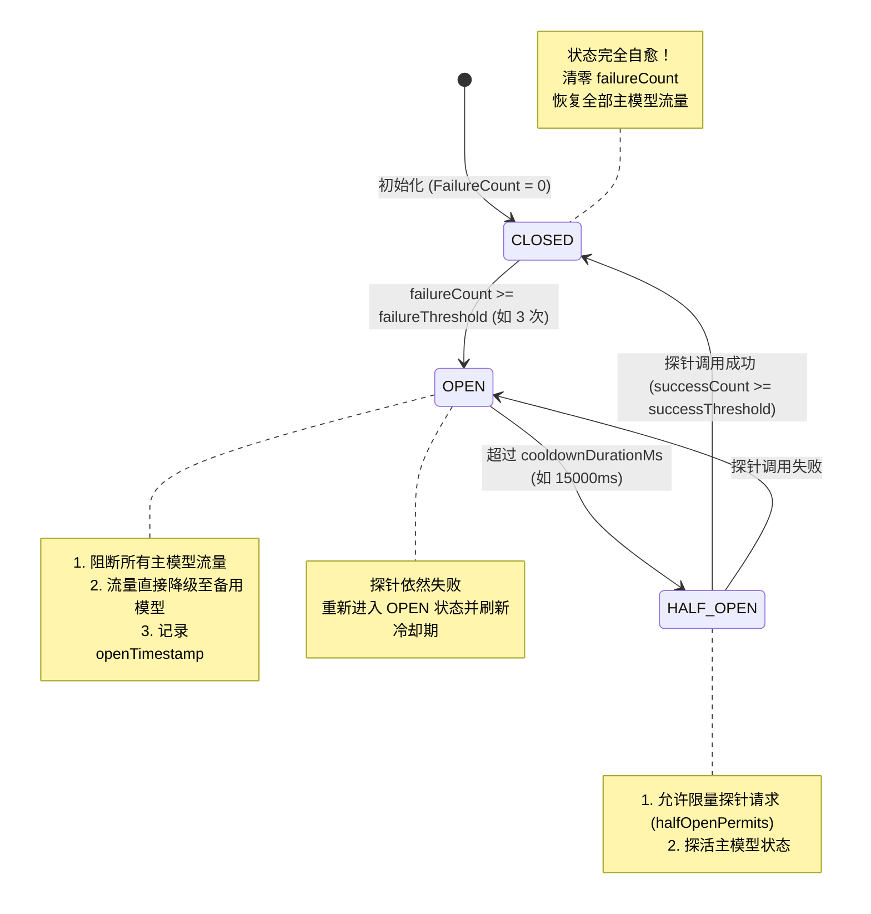
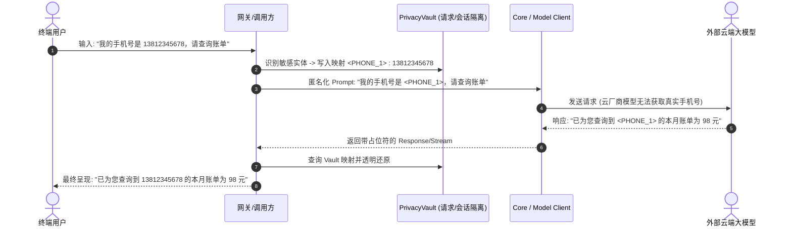
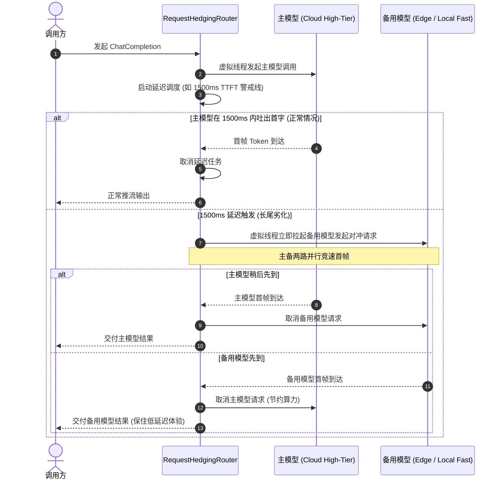

# Enterprise Resilience, Rate Limiting & Privacy Vault Specification (Phase 4)

## 1. Overview & Context

对标业界领先的开源大模型网关（**LiteLLM**, **Portkey**, **Kong AI Gateway**）与大厂金融/企业级大模型服务平台的生产实践，本项目在完成基础核心治理、监控闭环（Prometheus）、高并发基准压测（SQLite WAL）与 Multi-Agent Swarm 协同后，进一步构建工业级韧性与隐私安全体系。

本期方案分为两个里程碑：
- **Phase 4.1 (高可用韧性基座)**:
  1. **双轨滑动窗口限流器 (Dual Sliding-Window RateLimiter: RPM + TPM)**：支持 Tokens-Per-Minute 与 Requests-Per-Minute 毫秒级滑动窗口限流，具备基于 Prompt 的原子预估与 Provider 实际返回 Token 差额的校准机制。
  2. **自愈型三态熔断器 (Stateful Circuit Breaker)**：重构路由层单一计数器，实现完整的 `CLOSED` -> `OPEN` -> `HALF_OPEN` 三态状态机，支持冷却探测窗口、探针并发控制与自愈恢复。
- **Phase 4.2 (隐私安全与极致体验)**:
  3. **双向隐私脱敏保险库 (Bidirectional Privacy Vault)**：入站对 PII 敏感实体（手机号/身份证/银行卡/邮箱等）进行命名占位符伪匿名化，出站（流式/非流式）由网关根据会话级 Vault 自动透明反脱敏还原。
  4. **投机对冲竞速路由 (Request Hedging / Speculative Racing)**：基于虚拟线程在主模型 TTFT 超时（默认 1500ms）未出字时并行唤醒备用模型，双路竞速首帧，压降长尾 P99 延时。

---

## 2. Component Design (Phase 4.1)

### 2.1 双轨滑动窗口限流器 (RPM + TPM)

#### 2.1.1 核心痛点与数学模型
大模型云服务商（OpenAI, Azure, Anthropic, DeepSeek）的限流瓶颈主要在 **TPM (Tokens-Per-Minute)**，传统的单维 QPS/RPS 令牌桶无法防范“一次请求携带 32k tokens 导致上游 429”的问题。

滑动窗口模型采用 **环形多槽计数器 (Circular Time-Slot Bucket)**：
- 将 60 秒划分为 60 个 1000ms 的时间槽位；
- 每次请求根据当前系统时间戳定位槽位，并淘汰 60 秒前的数据；
- 请求到达时：
  1. 预估 Prompt Tokens（中文字符/英文字词加权，或 `Math.max(1, charLength / 3)`）；
  2. 原子累加窗口内总请求数与总 Tokens；
  3. 若 `windowRequests + 1 > rpmLimit`，返回 429 (Reason: `RPM_EXCEEDED`)；
  4. 若 `windowTokens + estimatedTokens > tpmLimit`，返回 429 (Reason: `TPM_EXCEEDED`)；
  5. 校验通过则原子计入槽位；
  6. LLM 调用结束收到真实 `totalTokens` 后，调用 `recordUsage` 将差额 `(actualTokens - estimatedTokens)` 增量/减量更新到当前窗口槽位。

#### 2.1.2 关键类与契约
- `TenantEntity` 扩展字段：
  - `rpmLimit`: 租户每分钟请求上限（<=0 表示不限制）；
  - `tpmLimit`: 租户每分钟 Token 上限（<=0 表示不限制）。
- `com.enterprise.llm.ratelimit.RateLimitResult`:
  ```java
  public record RateLimitResult(boolean allowed, String rejectionReason, long retryAfterMs) {}
  ```
- `TenantRateLimiter` 核心方法：
  - `RateLimitResult tryAcquire(TenantEntity tenant, int estimatedTokens)`
  - `boolean tryAcquire(TenantEntity tenant)` // 向后兼容
  - `void recordUsage(TenantEntity tenant, long actualTokens, long estimatedTokens)`

---

### 2.2 自愈型三态熔断器 (Stateful Circuit Breaker)

#### 2.2.1 状态机模型



#### 2.2.2 线程安全与并发控制
- 状态跃迁使用 `AtomicReference<State>` 与 CAS 操作；
- `HALF_OPEN` 状态下使用 `Semaphore` 或 `AtomicInteger activePermits` 限制并发探针数（默认 1），防止在主模型刚恢复时瞬时并发将其再次打垮；
- 冷却期检查：在 `tryAcquirePermission()` 时惰性检查当前时间与 `openTimestamp` 的差值，若大于 `cooldownDurationMs`，通过 CAS 驱动状态从 `OPEN` 自动流转为 `HALF_OPEN`。

---

## 3. Component Design (Phase 4.2)

### 3.1 双向隐私脱敏保险库 (Bidirectional Privacy Vault)

#### 3.1.1 架构与处理流


#### 3.1.2 核心设计
- `PrivacyVault`: 会话/请求级线程安全的字典容器，保存 `Map<String, String> placeholderToOriginal` 与 `Map<String, String> originalToPlaceholder`；
- `PrivacyMaskingInterceptor`: 统一在请求入站时扫描并伪匿名化（Pseudonymization）；
- `PrivacyDeMaskingTransformer`: 支持普通文本反替换与流式 SSE Token 反替换（对跨 Token 切分的占位符做轻量缓冲区滑动匹配）。

---

### 3.2 投机对冲竞速路由 (Request Hedging Router)

#### 3.2.1 竞速时序


---

## 4. Testing & Verification Plan

### 4.1 单元测试
1. `CircuitBreakerTest`:
   - 验证 `CLOSED` 连续失败达标后切换为 `OPEN`；
   - 验证 `OPEN` 期间拒绝请求；
   - 验证经过冷却时间后自动跃迁为 `HALF_OPEN`；
   - 验证 `HALF_OPEN` 探针成功后状态跃迁恢复为 `CLOSED` 并重置错误计数；
   - 验证 `HALF_OPEN` 探针失败后状态重新回到 `OPEN`。
2. `SlidingWindowRateLimiterTest`:
   - 验证 RPM 阈值拦截与 60s 滑动窗口自动释放；
   - 验证 TPM 阈值拦截（单次大 Token 请求超出上限直接拒绝）；
   - 验证 `recordUsage` 差额多退少补的准确性；
   - 验证高并发多线程下原子槽位计数无负数与死锁。
3. `FailoverRoutingServiceTest`:
   - 接入 `CircuitBreaker` 后的端到端自愈恢复测试。
4. `PrivacyVaultTest`:
   - 验证手机号、身份证、邮箱的双向脱敏与透明反脱敏。
5. `RequestHedgingRouterTest`:
   - 验证当主模型快时取消备用；当主模型慢（模拟 2000ms 延迟）时备用成功对冲并取消主模型。

### 4.2 集成回归测试
- 运行 `./mvnw clean verify`，确保已有全部 163 个用例 + 新增用例 100% 通过。
