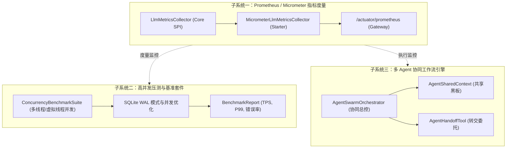

# 架构设计规约：可观测性度量、高并发压测基准与多Agent工作流协作

- **日期**: 2026-10-24
- **状态**: 待评审 / Approved
- **覆盖模块**: `llm-enterprise-core`, `llm-enterprise-spring-boot-starter`, `llm-enterprise-gateway-server`, `sample-business-app`

---

## 1. 背景与目标

在完成了前序四阶段（全链路 Trace 追踪、多租户 Session SPI、工作记忆 Working Memory 脱水与 Tool 虚拟线程并发）之后，系统已具备企业级骨架。为支持大规模生产落地与复杂业务场景演进，需要补齐三项关键能力：
1. **指标度量闭环 (Metrics Observability)**：基于 Prometheus & Micrometer 暴露标准端点，度量请求数、耗时、TTFT、TPS、Token 消耗及工具延迟；
2. **高并发压测与基准体系 (Concurrency Benchmark Suite)**：提供多线程/虚拟线程与 SQLite 并发持久化的自动化性能基准测试与报告，验证系统稳定性与吞吐极限；
3. **多 Agent 协同工作流引擎 (Multi-Agent Swarm / Workflow Orchestrator)**：支持多角色 Agent 声明、基于上下文和意图的状态机流转、以及 Agent 间的无缝会话委托 (Handoff)。

---

## 2. 总体架构与子系统划分



---

## 3. 子系统一：Prometheus / Micrometer 指标度量集成

### 3.1 Core 核心层设计 (零外部框架依赖)
- **`LlmMetricsCollector` SPI**:
  ```java
  public interface LlmMetricsCollector {
      void recordRequest(String model, String tenantId, String status, long durationMs, Long ttftMs, Double tps, int promptTokens, int completionTokens);
      void recordToolExecution(String toolName, String tenantId, String status, long durationMs);
      void recordActiveRequest(String model, int delta);
  }
  ```
- **默认实现**:
  - `NoOpMetricsCollector`: 核心层单例，当未配置外部度量系统时默认空操作，零开销。
  - `CompositeMetricsCollector`: 支持注册多个收集器实例广播分发。

### 3.2 Starter & Gateway 服务端实现
- 引入依赖：
  - `org.springframework.boot:spring-boot-starter-actuator`
  - `io.micrometer:micrometer-registry-prometheus`
- **`MicrometerLlmMetricsCollector`**:
  - `llm.requests.total`: Counter (tags: `model`, `tenant`, `status`)
  - `llm.request.duration`: Timer (tags: `model`, `tenant`, `stream`)
  - `llm.time.to.first.token`: Timer (tags: `model`, `tenant`)
  - `llm.tokens.per.second`: DistributionSummary (tags: `model`)
  - `llm.tokens.total`: Counter (tags: `model`, `tenant`, `type`)
  - `llm.tool.duration`: Timer (tags: `tool`, `tenant`, `status`)
  - `llm.active.requests`: AtomicInteger Gauge (tags: `model`)
- 暴露 `/actuator/prometheus` 端点，支持 Prometheus / Grafana 直接抓取。

---

## 4. 子系统二：高并发压测与基准体系 (Benchmark Suite)

### 4.1 压测目标与场景
1. **多租户并发会话写入基准**:
   - 验证 SQLite 在高并发写入下的锁竞争、响应延迟与连接池表现；
   - 启用 SQLite `PRAGMA journal_mode=WAL` 与 `PRAGMA busy_timeout=5000` 优化高并发读写分离。
2. **虚拟线程 Tool 并发执行基准**:
   - 模拟单轮产生 10 个独立耗时 Tool 调用（每个模拟 50ms 网络 I/O），对比虚拟线程并发调度（~50-60ms）与串行调度（~500ms）的吞吐与延迟。
3. **端到端网关混合并发压测**:
   - 结合 MockLLM，使用 50~100 并发虚拟线程持续施压 10 秒，输出 TPS、P50/P90/P99 延迟分布与错误率统计报告。

### 4.2 压测套件代码结构
- 新增 `com.enterprise.llm.benchmark.ConcurrencyBenchmarkSuite` 测试套件，包含：
  - `testSqliteConcurrentSessions()`: 50 线程并发写入 500 个不同租户/会话；
  - `testVirtualThreadToolParallelism()`: 验证高并发工具调度的线性加速比；
  - `testGatewayEndToEndUnderLoad()`: 验证全链路在压力下的 MDC 清理、Metrics 累加正确性与零内存泄漏。

---

## 5. 子系统三：多 Agent 协同工作流引擎 (Multi-Agent Swarm / Workflow)

### 5.1 核心概念设计
- **`AgentRole`**: 拥有名称、System Prompt、专属 Tool 集合的自主智能体角色（例如：`TriageAgent` 分诊顾问、`BillingAgent` 财务顾问、`TechnicalSupportAgent` 技术专家）。
- **`AgentHandoff`**: Agent 决定将当前任务转交给另一更专业 Agent 的结构化结果（包含目标 Agent 名称、转交理由与上下文补充）。
- **`AgentSharedContext`**: 跨 Agent 共享的状态与变量空间（黑板架构，Thread-safe）。
- **`AgentSwarmOrchestrator`**:
  - 管理 Agent 角色注册表；
  - 驱动 Agent 思考 -> 调用 Tool -> 触发 Handoff -> 切换激活 Agent -> 继续推理，直到产生最终用户回答；
  - 自动防止循环转交（设置 `maxHandoffTurns`，默认 5 次）；
  - 全流程透传 TraceContext 与 Metrics 埋点。

### 5.2 业务示例场景 (`sample-business-app`)
- 实现智能客服工单分诊工作流：
  1. 用户输入："我的订单 #1001 扣款成功了但是没收到 License 邮件，请帮我处理并退款"
  2. `TriageAgent` 分析意图，识别为财务与订单问题，通过 `transfer_to_billing` 动作转交；
  3. `BillingAgent` 接管上下文，调用 `OrderQueryTool` 查询订单状态，完成核验并给出专业答复。

---

## 6. 测试与验证策略

1. **自动化单元测试**:
   - `LlmMetricsCollectorTest`: 验证指标累加与边界（如负数 delta、空值）；
   - `MicrometerLlmMetricsCollectorTest`: 验证 Micrometer 抓取到的样本数值；
   - `AgentSwarmOrchestratorTest`: 验证多轮 Handoff、死循环熔断与最终响应输出。
2. **全流程压测验证**:
   - 执行 `ConcurrencyBenchmarkSuite` 并打印格式化性能指标表；
   - 验证在压力下 `/actuator/prometheus` 的计数器精准与日志无 MDC 串流。
3. **质量关卡**:
   - 全工程现有全部用例 100% 保持通过，新增用例覆盖率 > 90%。
